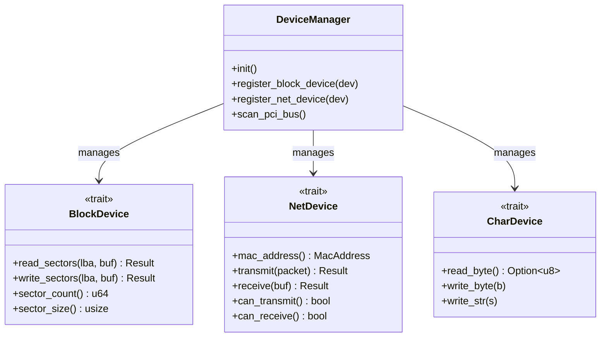

[ 🇷🇺 Русский ](drivers.ru.md) | [ 🇬🇧 English ](drivers.en.md)

# Wunix Core Hardware and Device Drivers Architecture

The driver subsystem in the Wunix operating system ([`kernel/src/drivers/`](file:///home/valdis/my-os/wunix/kernel/src/drivers)) is built upon modular architectural principles: all physical and virtual hardware is isolated behind strict interface traits, while device discovery and lifecycle management are orchestrated by the **DeviceManager**.

---

## 1. DeviceManager and Driver Abstraction Traits

In accordance with Wunix kernel design standards, kernel business logic avoids hardcoded hardware dependencies. Devices implement unified traits ([`drivers/traits.rs`](file:///home/valdis/my-os/wunix/kernel/src/drivers/traits.rs)):



### Core Device Traits:
1. **`BlockDevice`**: Synchronous sector-based I/O (512-byte blocks). Powers block storage devices such as `virtio-blk`, AHCI, and NVMe controllers. Forms the foundation of `/dev/vda` and FAT32/EXT4 filesystems.
2. **`NetDevice`**: Frame-level Ethernet transmit and receive interface (`virtio-net`, Intel e1000, Realtek). Connects directly to the `smoltcp` network stack.
3. **`CharDevice`**: Stream-oriented character I/O (UART serial ports, virtual terminals).

---

## 2. PCI Bus Subsystem (`drivers/pci/`)

The kernel scans the **PCI** (Peripheral Component Interconnect) bus hierarchy at startup:

1. **Configuration Space Access (`pci/config.rs`)**:
   - Accesses standard x86 I/O ports:
     - `0xCF8` (`PCI_CONFIG_ADDRESS`).
     - `0xCFC` (`PCI_CONFIG_DATA`).
2. **Bus Topology Scanning (`pci/scan.rs`)**:
   - Enumerates 256 buses, 32 devices, and 8 functions.
   - For every discovered hardware function, the kernel queries:
     - `Vendor ID` (e.g. `0x1AF4` for Red Hat / VirtIO, `0x8086` for Intel);
     - `Device ID` (specific controller model);
     - `Class Code` and `Subclass Code` (storage, network, display, bridge);
     - Base Address Registers (BARs) — MMIO address windows or I/O port spaces.
3. **Automated Registration**: Detected hardware is cataloged under `/sys/devices/pci` and mapped to matching drivers.

---

## 3. VirtIO Virtualization Stack (`drivers/virtio/`)

To deliver near-native performance inside virtual machines and hypervisors (QEMU, KVM), Wunix includes a complete implementation of the **VirtIO** standard:

```
drivers/virtio/
├── transport.rs      # VirtIO over PCI transport (queue discovery, status flags)
├── queue.rs          # Virtqueue implementation (Descriptor Table, Available Ring, Used Ring)
├── blk.rs            # virtio-blk block storage driver
├── net.rs            # virtio-net network interface driver
├── gpu.rs            # virtio-gpu graphics acceleration driver
└── input.rs          # virtio-input event input driver
```

### 3.1. Virtqueue Ring Buffers
Communication between the kernel and the hypervisor relies upon three zero-copy circular memory buffers:
- **Descriptor Table**: Array of physical memory addresses, buffer lengths, and access flags (`VRING_DESC_F_NEXT`, `VRING_DESC_F_WRITE`).
- **Available Ring**: Array of descriptor indexes ready for host processing.
- **Used Ring**: Array of processed descriptors and written byte counts returned by the host.

### 3.2. Block Storage: `virtio-blk`
- Discovered via PCI Vendor `0x1AF4` and Device ID `0x1001` (Legacy) or `0x1042` (Modern).
- Implements `BlockDevice`.
- Supports read (`VIRTIO_BLK_T_IN`), write (`VIRTIO_BLK_T_OUT`), and cache flush (`VIRTIO_BLK_T_FLUSH`) commands.
- Registered as `/dev/vda`, hosting partitions such as `/dev/vda1`.

### 3.3. Network Adapter: `virtio-net`
- Discovered via Device ID `0x1000` / `0x1041`.
- Manages dedicated `rx_queue` and `tx_queue` virtqueues.
- Retrieves hardware MAC address and integrates into the kernel network stack as `eth0`.

### 3.4. Accelerated Display: `virtio-gpu`
- Discovered via Device ID `0x1050`.
- Provides 2D display commands, frame attachment (backing store), and display flush operations.

### 3.5. Input Devices: `virtio-input`
- Discovered via Device ID `0x1052`.
- Delivers mouse pointer coordinates, click events, and keyboard keys to the kernel.

---

## 4. Platform x86 Drivers

In addition to modern PCI and VirtIO hardware, Wunix maintains native low-level drivers for classic PC architecture components:

### 4.1. UART 16550 Serial Port (`drivers/serial.rs`)
- Operates at I/O port `0x3F8` (COM1).
- Initializes hardware at 115200 baud (divisor 1), 8N1 format, with FIFO buffer enabled.
- Acts as the primary debugging channel, mirroring `kprint!` output to the host console.

### 4.2. PS/2 Keyboard Controller (`drivers/keyboard.rs`)
- Servicing hardware interrupt IRQ1 (data port `0x60`, status port `0x64`).
- Backed by an interrupt-safe non-blocking `RingBuffer<char, 128>`.
- Features a state-machine scan code decoder:
  - Shift, Ctrl, Alt, CapsLock modifiers;
  - Dual layout support (English and Russian);
  - Dynamic layout switching with `Alt+Shift`;
  - Input cancellation on `Ctrl+C`.

### 4.3. CMOS Real-Time Clock RTC (`drivers/rtc.rs`)
- Interfaces with the Motorola MC146818 chip at ports `0x70` (register address) and `0x71` (data).
- Reads hardware date and time with BCD decoding and 24-hour mode conversion.
- Seeds the system boot time during initialization.

### 4.4. Framebuffer Console Driver (`drivers/display.rs`, `drivers/font.rs`)
- Renders to Limine linear 32-bit graphical framebuffer (TrueColor ARGB).
- Draws characters using an 8×16 bitmap font with complete ASCII and Cyrillic glyphs.
- High-performance terminal implementation:
  - ANSI escape code decoding (text colors `\x1b[31m`..`\x1b[37m`, background colors `\x1b[40m`..`\x1b[47m`, resets);
  - Fast memory copying on scroll (`memmove`);
  - Proper handling of carriage return (`\r`), line feed (`\n`), tab (`\t`), and Backspace (`\x08`).
