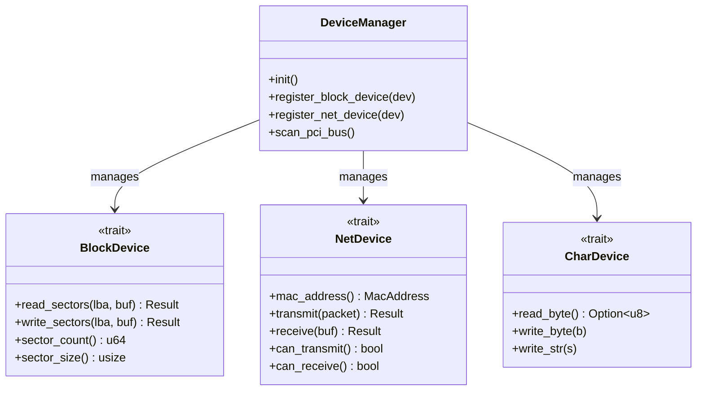

[ 🇷🇺 Русский ](drivers.ru.md) | [ 🇬🇧 English ](drivers.en.md)

# Подсистема оборудования и драйверов Wunix Core

Подсистема драйверов операционной системы Wunix ([`kernel/src/drivers/`](file:///home/valdis/my-os/wunix/kernel/src/drivers)) построена по модульному принципу: все физические и виртуальные устройства изолированы за строгими интерфейсными типажами (`traits`), а управление жизненным циклом и обнаружение оборудования централизованы в диспетчере **DeviceManager**.

---

## 1. Архитектура DeviceManager и абстракции драйверов

В соответствии с правилами проектирования ядра Wunix, код ядра никогда не привязывается к конкретному физическому железу напрямую. Взаимодействие осуществляется через абстрактные интерфейсы ([`drivers/traits.rs`](file:///home/valdis/my-os/wunix/kernel/src/drivers/traits.rs)):



### Ключевые типажи устройств:
1. **`BlockDevice`**: Синхронный блочный ввод-вывод 512-байтными секторами (используется драйверами дисков `virtio-blk`, AHCI, NVMe). На базе `BlockDevice` в VFS функционирует блочный слой `/dev/vda` и монтируются файловые системы FAT32/EXT4.
2. **`NetDevice`**: Прием и отправка Ethernet-пакетов сетевого уровня (драйверы `virtio-net`, Intel e1000, Realtek). Подключается напрямую к сетевому стеку `smoltcp`.
3. **`CharDevice`**: Потоковый побайтовый ввод-вывод (драйвер последовательного порта `serial`, виртуальные терминалы).

---

## 2. Подсистема шины PCI (`drivers/pci/`)

Ядро Wunix выполняет автоматическое аппаратное сканирование шины **PCI** (Peripheral Component Interconnect) при старте:

1. **Доступ к конфигурационному пространству (`pci/config.rs`)**:
   - Чтение и запись выполняются через стандартные порты ввода-вывода x86:
     - Порт адреса `0xCF8` (`PCI_CONFIG_ADDRESS`).
     - Порт данных `0xCFC` (`PCI_CONFIG_DATA`).
2. **Сканирование топологии (`pci/scan.rs`)**:
   - Диспетчер опрашивает все 256 шин (Bus 0..255), 32 устройства (Device 0..31) и 8 функций (Function 0..7).
   - Для каждого найденного устройства считываются:
     - `Vendor ID` (идентификатор производителя, например `0x1AF4` для Red Hat / VirtIO или `0x8086` для Intel);
     - `Device ID` (модель устройства);
     - `Class Code` и `Subclass Code` (тип контроллера: накопитель, сетевой адаптер, дисплей, мост);
     - Базовые регистры адреса BAR (Base Address Registers) — диапазоны MMIO или портов I/O.
3. **Автоконфигурация**: Обнаруженные устройства регистрируются в системном каталоге `/sys/devices/pci` и связываются с соответствующими драйверами ядра.

---

## 3. Стек драйверов виртуализации VirtIO (`drivers/virtio/`)

Для максимальной производительности в средах эмуляции и гипервизорах (QEMU, KVM, VirtualBox) в ядре реализован полный стек драйверов спецификации **VirtIO**:

```
drivers/virtio/
├── transport.rs      # Транспортный уровень VirtIO over PCI (обнаружение очередей, статусные регистры)
├── queue.rs          # Очереди сообщений Virtqueue (Descriptor Table, Available Ring, Used Ring)
├── blk.rs            # Драйвер блочного дискового накопителя virtio-blk
├── net.rs            # Драйвер сетевого адаптера virtio-net
├── gpu.rs            # Драйвер видеоускорителя virtio-gpu
└── input.rs          # Драйвер манипуляторов ввода virtio-input
```

### 3.1. Структура очередей дескрипторов (`Virtqueue`)
Взаимодействие ядра с гипервизором построено на трех кольцевых буферах памяти без копирования (Zero-Copy):
- **Таблица дескрипторов (Descriptor Table)**: Массив адресов физической памяти, длин буферов и флагов доступа (`VRING_DESC_F_NEXT`, `VRING_DESC_F_WRITE`).
- **Кольцо доступных буферов (Available Ring)**: Буфер индексов, передаваемых ядром в устройство для обработки.
- **Кольцо использованных буферов (Used Ring)**: Буфер индексов и длин обработанных данных, возвращаемых гипервизором.

### 3.2. Драйвер диска `virtio-blk`
- Идентифицируется по PCI Vendor `0x1AF4` и Device ID `0x1001` (Legacy) или `0x1042` (Modern).
- Реализует типаж `BlockDevice`.
- Поддерживает запросы чтения (`VIRTIO_BLK_T_IN`), записи (`VIRTIO_BLK_T_OUT`) и сброса кэша (`VIRTIO_BLK_T_FLUSH`).
- Предоставляет ядру накопитель `/dev/vda`, поверх которого монтируются постоянные разделы MBR/FAT32.

### 3.3. Сетевой адаптер `virtio-net`
- Идентифицируется по Device ID `0x1000` / `0x1041`.
- Выделяет независимые очереди `rx_queue` (прием пакетов) и `tx_queue` (передача пакетов).
- Считывает физический MAC-адрес сетевой карты и подключается к сетевому стеку ядра как интерфейс `eth0`.

### 3.4. Видеоускоритель `virtio-gpu`
- Идентифицируется по Device ID `0x1050`.
- Поддерживает 2D-команды создания ресурсов дисплея, привязку к системной памяти (backing store) и сброс фреймбуфера на экран хоста.

### 3.5. Устройства ввода `virtio-input`
- Идентифицируется по Device ID `0x1052`.
- Обеспечивает прямую трансляцию событий манипулятора мышь (координаты, нажатия кнопок) и мультимедийных клавиш в ядро.

---

## 4. Классические платформенные драйверы x86

Помимо современных устройств VirtIO и шины PCI, ядро содержит набор низкоуровневых драйверов стандартного x86-оборудования:

### 4.1. Последовательный порт UART 16550 (`drivers/serial.rs`)
- Работает через порт ввода-вывода `0x3F8` (COM1).
- Инициализирует контроллер на скорость 115200 бод (делитель 1), формат 8N1 (8 бит данных, без четности, 1 стоп-бит), включает буфер FIFO.
- Служит основным каналом вывода отладочных сообщений ядра (`kprint!`) в терминал хост-системы.

### 4.2. Контроллер клавиатуры PS/2 (`drivers/keyboard.rs`)
- Обслуживает аппаратное прерывание IRQ1 (порт данных `0x60`, порт статуса `0x64`).
- Использует неблокирующий потокобезопасный кольцевой буфер `RingBuffer<char, 128>`.
- Реализует полноценный автомат состояний скан-кодов:
  - Модификаторы Shift, Ctrl, Alt, CapsLock;
  - Двойная раскладка клавиатуры (английская и русская);
  - Переключение раскладок по комбинации `Alt+Shift`;
  - Аппаратный сброс текущей строки ввода по прерыванию `Ctrl+C`.

### 4.3. Энергонезависимые часы CMOS RTC (`drivers/rtc.rs`)
- Взаимодействуют с чипом Motorola MC146818 через порты `0x70` (адрес регистра) и `0x71` (данные).
- Считывают текущую дату и время реального времени с автоопределением двоично-десятичного кодирования (BCD) и 24-часового формата.
- Инициализируют глобальное базовое время ядра при старте системы.

### 4.4. Видеодрайвер консоли (`drivers/display.rs`, `drivers/font.rs`)
- Работает поверх линейного 32-битного графического фреймбуфера Limine (TrueColor ARGB).
- Отрисовывает текст растровым знакогенератором 8×16 пикселей с полной поддержкой латиницы и кириллицы.
- Реализует высокопроизводительный терминальный движок:
  - Парсинг escape-последовательностей ANSI (цвета текста `\x1b[31m`..`\x1b[37m`, фоновые цвета `\x1b[40m`..`\x1b[47m`, сброс атрибутов);
  - Аппаратное копирование строк памяти при скроллинге вверх (`memmove`);
  - Обработка управляющих символов `\r`, `\n`, `\t` и клавиши Backspace (`\x08`).
