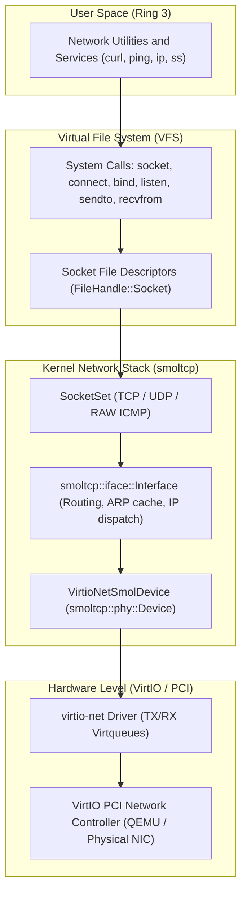

[ 🇷🇺 Русский ](network.ru.md) | [ 🇬🇧 English ](network.en.md)

# Wunix Core Network Stack Architecture

The network subsystem of Wunix ([`kernel/src/net/`](file:///home/valdis/my-os/wunix/kernel/src/net)) integrates the hardware `virtio-net` adapter driver with the standalone, zero-copy **smoltcp** embedded TCP/IP stack.

---

## 1. Network Pipeline Architecture

Network traffic traverses three core layers: from hardware virtqueue interrupts to userland BSD socket descriptors:



---

## 2. Device Adapter `VirtioNetSmolDevice` (`net/device.rs`)

The bridge connecting physical/virtual hardware to higher-level protocols is `VirtioNetSmolDevice`, implementing `smoltcp::phy::Device`:

1. **Transmit and Receive Tokens**:
   - `VirtioRxToken`: Ingests complete raw Ethernet frames (including the 14-byte MAC header) from the `rx_queue` of `virtio-net`.
   - `VirtioTxToken`: Acquires device lock and transmits formed packets across the `tx_queue` to the host hypervisor.
2. **Device Capabilities**:
   - Maximum Transmission Unit (MTU): 1500 bytes (Ethernet frame size 1514 bytes).
   - Medium: `Medium::Ethernet`.
   - Checksums: In-software calculation and verification of IPv4, TCP, and UDP packet checksums.

---

## 3. Global Network Stack `NetworkStack` (`net/mod.rs`)

Global networking state is tracked in the thread-safe singleton `static NET_STACK: Mutex<Option<NetworkStack>>`:

```rust
pub struct NetworkStack {
    pub iface: Interface,
    pub device: VirtioNetSmolDevice,
    pub sockets: SocketSet<'static>,
    pub mac: [u8; 6],
    pub ip: [u8; 4],
    pub netmask: [u8; 4],
    pub gateway: [u8; 4],
    pub dns: [u8; 4],
}
```

### Default QEMU Network Configuration:
- **IP Address**: `10.0.2.15/24` (QEMU SLIRP standard user network).
- **Subnet Mask**: `255.255.255.0`.
- **Default Gateway**: `10.0.2.2`.
- **DNS Server**: `10.0.2.3`.

This configuration can be updated dynamically at runtime via the `ip` tool.

---

## 4. Supported Network Protocols

1. **Ethernet II**: Decodes 14-byte headers (Source/Destination MAC, EtherType `0x0800` IPv4, `0x0806` ARP).
2. **ARP (Address Resolution Protocol)**:
   - Dynamic translation of local IP addresses into MAC addresses.
   - In-memory ARP lookup table with entry expiration.
3. **IPv4**:
   - Header checksum validation, TTL handling, and protocol multiplexing.
   - Subnet-aware gateway routing.
4. **ICMP (Internet Control Message Protocol)**:
   - Automated Echo Request handling (`Echo Request` $\to$ `Echo Reply`).
   - Supports `SOCK_RAW` sockets powering `ping`.
5. **UDP (User Datagram Protocol)**:
   - Non-blocking datagram transport via `SOCK_DGRAM`.
   - Supports `sendto` and `recvfrom` preserving peer IP endpoints.
6. **TCP (Transmission Control Protocol)**:
   - Complete state-machine implementation (CLOSED, LISTEN, SYN_SENT, SYN_RECEIVED, ESTABLISHED, FIN_WAIT, CLOSE_WAIT, LAST_ACK, TIME_WAIT).
   - Reliable streaming: 3-way handshake, sliding window flow control, ACK tracking, and retransmission timeouts.

---

## 5. Socket Integration in VFS (`fs/socket.rs`)

Network sockets are first-class VFS citizens implementing `FileHandle`:

- **Socket Creation (`sys_socket`)**: Allocates a file descriptor in `FdTable` and registers a socket handle within the kernel `SocketSet`.
- **Connecting (`sys_connect`)**: Dispatches a SYN packet to a remote destination and transitions state to `SYN_SENT`.
- **Streaming (`sys_read`, `sys_write`, `sys_sendto`, `sys_recvfrom`)**: Transfers data directly between userland buffers and socket buffers.
- **Multiplexing (`poll_events`)**: Signals `EPOLLIN`, `EPOLLOUT`, and `EPOLLERR` readiness states for seamless `epoll` reactor integration.

---

## 6. Wunix Network CLI Utilities

Wunix userland provides essential network diagnostic and configuration commands:

| Utility | Man Section | Purpose |
|:---|:---:|:---|
| **`ip`** | `ip(8)` | Inspects network interfaces, views MAC addresses, configures IP addresses and default gateways. |
| **`ping`** | `ping(8)` | Tests network node reachability using ICMP Echo Requests measuring RTT in milliseconds. |
| **`curl`** | `curl(1)` | HTTP client fetching web resources, inspecting HTTP response headers, and testing REST APIs. |
| **`ss`** | `ss(8)` | Socket Statistics viewer displaying active TCP and UDP listening ports and connection states. |
