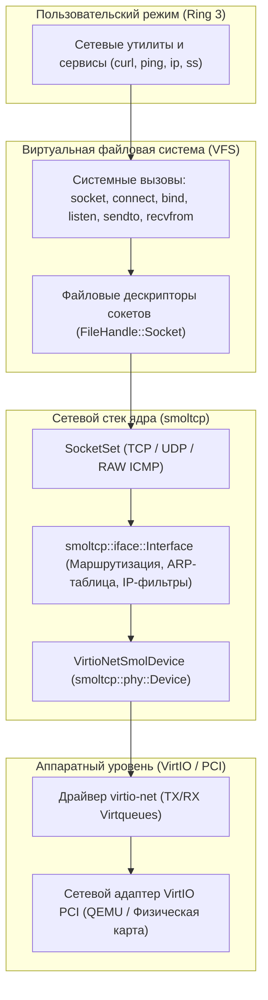

[ 🇷🇺 Русский ](network.ru.md) | [ 🇬🇧 English ](network.en.md)

# Архитектура сетевого стека Wunix Core

Сетевой стек операционной системы Wunix ([`kernel/src/net/`](file:///home/valdis/my-os/wunix/kernel/src/net)) построен на интеграции аппаратного драйвера `virtio-net` с автономным высокопроизводительным встраиваемым стеком **smoltcp**. Это гарантирует надежность, отсутствие утечек памяти и устойчивость к ошибкам повреждения сетевых пакетов.

---

## 1. Архитектурная схема сетевого конвейера

Сетевой поток проходит через три уровня ядра: от аппаратных прерываний сетевой карты до пользовательских дескрипторов BSD-сокетов:



---

## 2. Адаптер устройства `VirtioNetSmolDevice` (`net/device.rs`)

Связующим звеном между железом и сетевыми протоколами выступает адаптер `VirtioNetSmolDevice`, реализующий типаж `smoltcp::phy::Device`:

1. **Токены передачи и приема**:
   - `VirtioRxToken`: Принимает полный сырой Ethernet-кадр (включая 14-байтный заголовок MAC) из очереди `rx_queue` драйвера `virtio-net`.
   - `VirtioTxToken`: Захватывает мьютекс сетевого адаптера и отправляет сформированный пакет через очередь `tx_queue` гипервизору.
2. **Аппаратные возможности (DeviceCapabilities)**:
   - Максимальный размер пакета (MTU): 1500 байт (Ethernet frame size 1514 байт).
   - Поддерживаемая среда: `Medium::Ethernet`.
   - Контрольные суммы: программный расчет и верификация чексумм IPv4, TCP и UDP.

---

## 3. Глобальный стек `NetworkStack` (`net/mod.rs`)

Глобальное состояние сети хранится в потокобезопасном синглтоне `static NET_STACK: Mutex<Option<NetworkStack>>`:

```rust
pub struct NetworkStack {
    pub iface: Interface,
    pub device: VirtioNetSmolDevice,
    pub sockets: SocketSet<'static>,
    pub mac: [u8; 6],
    pub ip: [u8; 4],
    pub netmask: [u8; 4],
    pub gateway: [u8; 4],
    pub dns: [u8; 4],
}
```

### Сетевая конфигурация по умолчанию в QEMU:
- **IP-адрес**: `10.0.2.15/24` (стандартная подсеть виртуального маршрутизатора QEMU SLIRP).
- **Сетевая маска**: `255.255.255.0`.
- **Шлюз по умолчанию**: `10.0.2.2`.
- **DNS-сервер**: `10.0.2.3`.

Конфигурация может быть изменена динамически без перезагрузки системы с помощью системной утилиты `ip`.

---

## 4. Поддерживаемые протоколы

1. **Ethernet II**: Разбор 14-байтных заголовков (MAC-адрес источника, назначения, EtherType `0x0800` для IPv4, `0x0806` для ARP).
2. **ARP (Address Resolution Protocol)**:
   - Автоматическое разрешение IP-адресов локальной подсети в аппаратные MAC-адреса.
   - Динамическая ARP-таблица в оперативной памяти с автоматическим устареванием записей.
3. **IPv4**:
   - Проверка контрольной суммы заголовка, разбор TTL и полей протоколов.
   - Маршрутизация через локальную таблицу шлюзов.
4. **ICMP (Internet Control Message Protocol)**:
   - Автоматический ответ на входящие запросы эхо (`Echo Request` $\to$ `Echo Reply`).
   - Поддержка сокетов типа `SOCK_RAW` для реализации диагностической утилиты `ping`.
5. **UDP (User Datagram Protocol)**:
   - Неблокирующий прием и отправка датаграмм через сокеты `SOCK_DGRAM`.
   - Поддержка системных вызовов `sendto` и `recvfrom` с сохранением IP-адреса отправителя.
6. **TCP (Transmission Control Protocol)**:
   - Полноценная конечная автоматная модель состояний TCP (CLOSED, LISTEN, SYN_SENT, SYN_RECEIVED, ESTABLISHED, FIN_WAIT, CLOSE_WAIT, LAST_ACK, TIME_WAIT).
   - Надежная доставка: трехэтапное рукопожатие (3-way handshake), скользящее окно передачи (Sliding Window), отслеживание подтверждений (ACK) и тайм-ауты повторной передачи (Retransmission).

---

## 5. Сокетная интеграция с VFS (`fs/socket.rs`)

Сетевые сокеты в Wunix являются равноправными объектами VFS, реализующими трейт `FileHandle`:

- **Создание сокета (`sys_socket`)**: Аллоцирует новый дескриптор в `FdTable` вызывающего процесса и создает соответствующий сокет в `SocketSet` ядра.
- **Подключение (`sys_connect`)**: Инициирует исходящее TCP-соединение с удаленным адресом и портом, переводя сокет в статус `SYN_SENT`.
- **Чтение и запись (`sys_read`, `sys_write`, `sys_sendto`, `sys_recvfrom`)**: Прозрачно направляют байтовые потоки в кольцевые буферы передачи и приема соответствующего сокета `smoltcp`.
- **Опрос состояния (`poll_events`)**: Сокеты возвращают флаги готовности `EPOLLIN`, `EPOLLOUT`, `EPOLLERR`, что позволяет интегрировать сетевой ввод-вывод в реактор событий `epoll`.

---

## 6. Консольные сетевые утилиты Wunix

В пользовательском окружении Wunix доступен набор классических инструментов сетевого администрирования:

| Утилита | Раздел man | Назначение |
|:---|:---:|:---|
| **`ip`** | `ip(8)` | Отображение сетевых интерфейсов, просмотр MAC-адреса, назначение статического IP-адреса и шлюза. |
| **`ping`** | `ping(8)` | Проверка доступности сетевых узлов через отправку ICMP Echo Request пакетов с измерением времени RTT в миллисекундах. |
| **`curl`** | `curl(1)` | HTTP-клиент для загрузки веб-страниц, проверки ответов серверов и выполнения сетевых HTTP GET запросов. |
| **`ss`** | `ss(8)` | Статистика открытых сокетов (Socket Statistics): просмотр списка активных TCP/UDP портов, состояния соединений и дескрипторов. |
