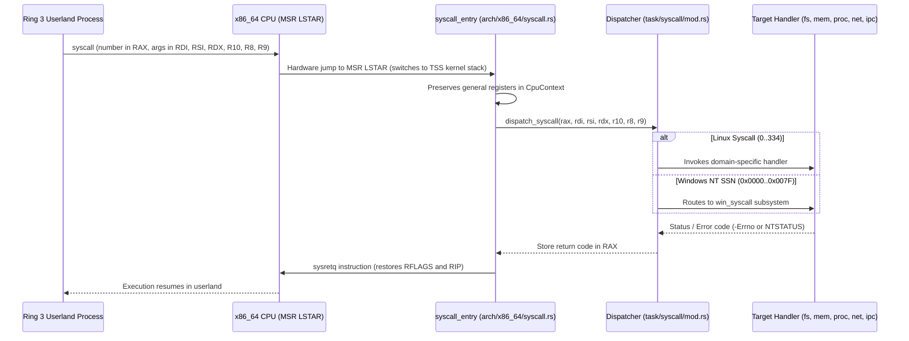

[ 🇷🇺 Русский ](syscalls.ru.md) | [ 🇬🇧 English ](syscalls.en.md)

# Wunix Kernel System Calls Architecture (Dual ABI)

The system call architecture in **Wunix Core** implements a high-performance Dual ABI interface: the kernel natively dispatches standard **Linux / POSIX** system calls while simultaneously supporting System Service Numbers (SSN) from the **Windows NT** subsystem.

---

## 1. Hardware Transition Mechanism (x86_64 Syscall Gateway)

Userland applications (Ring 3, DPL=3) transition into kernel space (Ring 0, DPL=0) using the x86_64 `syscall` instruction:

### Argument Passing Conventions:
- **System Call Number**: register `RAX`.
- **Arguments (up to 6 parameters)**: `RDI` (1), `RSI` (2), `RDX` (3), `R10` (4), `R8` (5), `R9` (6).
- **Return Value**: register `RAX`. Successful calls return `0` or positive integers; failures return negative `-Errno` codes (Linux ABI) or `NTSTATUS` (NT ABI).
- **Pointer Validation**: Every user pointer is validated via `validate_user_ptr`. Addresses exceeding `0x0000_7FFF_FFFF_FFFF` are rejected with `-EFAULT`.

---

## 2. Linux & POSIX ABI System Calls

Linux ABI dispatchers are structured according to Single Responsibility Principle (SRP) under `kernel/src/task/syscall/`:

### 2.1. File I/O and Descriptors (`syscall/fs.rs`)
| Syscall | Number | Signature | Purpose |
|:---|:---:|:---|:---|
| `sys_read` | `0` | `fd, buf, count` | Reads data from an open file, terminal, socket, or pipe into a user buffer. |
| `sys_write` | `1` | `fd, buf, count` | Writes data to a file or prints text to the console with ANSI color decoding. |
| `sys_open` | `2` | `filename, flags, mode` | Opens or creates a file at the specified path. |
| `sys_close` | `3` | `fd` | Closes a file descriptor and frees the kernel handle. |
| `sys_stat` | `4` | `filename, statbuf` | Returns file metadata by path, traversing symlinks. |
| `sys_fstat` | `5` | `fd, statbuf` | Returns file metadata by open file descriptor. |
| `sys_lstat` | `6` | `filename, statbuf` | Returns metadata of a symlink itself without following it. |
| `sys_lseek` | `8` | `fd, offset, whence` | Adjusts the read/write file offset (`SEEK_SET`, `SEEK_CUR`, `SEEK_END`). |
| `sys_ioctl` | `16` | `fd, cmd, arg` | Controls device parameters (e.g., queries terminal window size `TIOCGWINSZ`). |
| `sys_pread64` | `17` | `fd, buf, count, pos` | Reads data from a fixed offset without changing the file position. |
| `sys_pwrite64` | `18` | `fd, buf, count, pos` | Writes data at a fixed offset without advancing the file cursor. |
| `sys_readv` | `19` | `fd, iov, iovcnt` | Vectorized scatter-read into multiple discontinuous user buffers. |
| `sys_writev` | `20` | `fd, iov, iovcnt` | Vectorized gather-write from multiple buffers into a single stream. |
| `sys_access` | `21` | `filename, mode` | Tests file accessibility permissions (`R_OK`, `W_OK`, `X_OK`, `F_OK`). |
| `sys_dup` | `32` | `oldfd` | Duplicates a file descriptor into the lowest available slot in `FdTable`. |
| `sys_dup2` | `33` | `oldfd, newfd` | Duplicates a descriptor into an explicit target number `newfd`. |
| `sys_dup3` | `292` | `oldfd, newfd, flags` | Duplicates descriptor atomically setting `O_CLOEXEC`. |
| `sys_fcntl` | `72` | `fd, cmd, arg` | Manipulates descriptor attributes (e.g., enables `O_NONBLOCK`). |
| `sys_truncate` | `76` | `path, length` | Truncates or extends a file by path to a specified length. |
| `sys_ftruncate` | `77` | `fd, length` | Truncates or extends an open file by descriptor. |
| `sys_sync` | `162` | — | Flushes dirty VFS buffers to block storage (`virtio-blk`). |
| `sys_mount` | `165` | `dev, dir, type, flags, data` | Mounts a filesystem (FAT32, RamFS) onto a VFS directory. |
| `sys_umount2` | `166` | `target, flags` | Unmounts a filesystem from the VFS hierarchy. |
| `sys_openat` | `257` | `dirfd, path, flags, mode` | Opens a file relative to directory descriptor `dirfd` or `AT_FDCWD`. |
| `sys_newfstatat` | `262` | `dirfd, path, statbuf, flags` | Obtains file metadata by relative or absolute path. |

### 2.2. Directory Navigation and Node Management (`syscall/dir.rs`)
| Syscall | Number | Signature | Purpose |
|:---|:---:|:---|:---|
| `sys_getcwd` | `79` | `buf, size` | Returns the canonical path of the current process working directory. |
| `sys_chdir` | `80` | `path` | Changes current working directory (supports Unix paths and Windows drives `C:\...`). |
| `sys_rename` | `82` | `oldname, newname` | Renames or moves a file/directory within the VFS tree. |
| `sys_mkdir` | `83` | `pathname, mode` | Creates a new directory in the filesystem. |
| `sys_rmdir` | `84` | `pathname` | Removes an empty directory. |
| `sys_unlink` | `87` | `pathname` | Unlinks and deletes a file from the filesystem. |
| `sys_symlink` | `88` | `target, linkpath` | Creates a symbolic link pointing to a file or directory. |
| `sys_readlink` | `89` | `path, buf, bufsiz` | Reads the target path stored inside a symbolic link. |
| `sys_statfs` | `137` | `path, buf` | Returns filesystem geometry and capacity metrics. |
| `sys_getdents64` | `217` | `fd, dirp, count` | Retrieves directory entries (names, inode IDs, types) for `ls` and `wsh`. |

### 2.3. Memory Management (`syscall/mem.rs`)
| Syscall | Number | Signature | Purpose |
|:---|:---:|:---|:---|
| `sys_mmap` | `9` | `addr, len, prot, flags, fd, off` | Allocates virtual memory pages (anonymous memory or file projections). |
| `sys_mprotect` | `10` | `addr, len, prot` | Modifies memory protection attributes (`PROT_READ`, `PROT_WRITE`). |
| `sys_munmap` | `11` | `addr, len` | Releases virtual memory page ranges and flushes TLB entries. |
| `sys_brk` | `12` | `brk` | Adjusts process heap break boundary for `malloc` support. |
| `sys_mincore` | `27` | `start, len, vec` | Determines whether pages are resident in physical RAM. |
| `sys_madvise` | `28` | `start, len_in, advice` | Supplies memory access hints to the kernel. |

### 2.4. Processes, Threads, and Scheduling (`syscall/proc.rs`, `syscall/mod.rs`)
| Syscall | Number | Signature | Purpose |
|:---|:---:|:---|:---|
| `sys_yield` | `24` | — | Cooperatively yields CPU time slice to other scheduled threads. |
| `sys_nanosleep` | `35` | `req, rem` | Suspends thread execution for a high-resolution time interval. |
| `sys_getpid` | `39` | — | Returns process identifier (PID / TGID). |
| `sys_clone` | `56` | `flags, stack, ptid, ctid, tls` | Spawns a thread sharing memory space with dedicated TLS (`FS_BASE`). |
| `sys_execve` | `59` | `filename, argv, envp` | Loads and executes an ELF64 or PE32+ executable over the current process. |
| `sys_exit` | `60` | `error_code` | Terminates the calling thread with an exit status code. |
| `sys_wait4` | `61` | `pid, stat_loc, options, rusage` | Waits for child process termination and collects exit status. |
| `sys_kill` | `62` | `pid, sig` | Dispatches a signal to a process (e.g. `SIGINT` interruption). |
| `sys_uname` | `63` | `buf` | Populates system metadata (OS name "Wunix", kernel version, architecture). |
| `sys_gettimeofday` | `96` | `tv, tz` | Obtains current UTC time with microsecond resolution. |
| `sys_sysinfo` | `99` | `info` | Returns system uptime, total RAM, and available free RAM. |
| `sys_syslog` | `103` | `type, bufp, len` | Reads kernel diagnostic ring buffer for `dmesg`. |
| `sys_arch_prctl` | `158` | `code, addr` | Sets CPU register `FS_BASE` for Thread Local Storage (TLS). |
| `sys_settimeofday` | `164` | `tv, tz` | Adjusts system clock and non-volatile CMOS RTC. |
| `sys_reboot` | `169` | `magic1, magic2, cmd, arg` | Reboots the system or powers off the hardware via ACPI. |
| `sys_gettid` | `186` | — | Returns unique thread identifier (`ThreadId`). |
| `sys_sched_getaffinity`| `204`| `pid, cpusetsize, mask` | Queries available CPU core mask (SMP). |
| `sys_set_tid_address` | `218` | `tidptr` | Registers clear_child_tid futex address for thread exit notification. |
| `sys_clock_settime` | `227` | `which_clock, tp` | Sets real-time system clock. |
| `sys_clock_gettime` | `228` | `which_clock, tp` | Reads high-resolution clocks (`CLOCK_MONOTONIC`, `CLOCK_REALTIME`). |
| `sys_exit_group` | `231` | `status` | Terminates all threads within the calling process. |
| `sys_tgkill` | `234` | `tgid, tid, sig` | Sends a signal to a specific thread within a thread group. |
| `sys_getrandom` | `318` | `buf, buflen, flags` | Generates cryptographically secure pseudorandom numbers from kernel entropy. |
| `sys_rseq` | `334` | — | Restartable Sequences stub (returns `-ENOSYS` to trigger libc TLS path). |

### 2.5. Credentials and Permissions (`syscall/creds.rs`)
| Syscall | Number | Signature | Purpose |
|:---|:---:|:---|:---|
| `sys_chmod` | `90` | `filename, mode` | Updates file permission bits (`rwx`). |
| `sys_fchmod` | `91` | `fd, mode` | Updates permission bits by open descriptor. |
| `sys_chown` | `92` | `filename, user, group` | Changes file owner and group (UID/GID). |
| `sys_fchown` | `93` | `fd, user, group` | Changes owner and group of an open file. |
| `sys_umask` | `95` | `mask` | Sets default permission mask for newly created files (default `022`). |
| `sys_getuid` | `102` | — | Returns real user ID (UID). |
| `sys_getgid` | `104` | — | Returns real group ID (GID). |
| `sys_setuid` | `105` | `uid` | Sets user UID (for `su`, `login`). |
| `sys_setgid` | `106` | `gid` | Sets process group GID. |
| `sys_geteuid` | `107` | — | Returns effective UID determining active access privileges. |
| `sys_getegid` | `108` | — | Returns effective GID of the process. |
| `sys_setpgid` | `109` | `pid, pgid` | Configures process group ID for job control in WSH. |
| `sys_getppid` | `110` | — | Returns parent process identifier (PPID). |
| `sys_getpgrp` | `111` | — | Returns process group ID of the calling process. |
| `sys_setsid` | `112` | — | Establishes a new terminal session with caller as leader. |
| `sys_getpgid` | `121` | `pid` | Queries process group ID for target PID. |
| `sys_prlimit64` | `302` | `pid, resource, new_limit, old_limit` | Queries and sets resource limits (open files, stack size). |

### 2.6. Inter-Process Communication (IPC) and Events (`syscall/ipc.rs`, `futex.rs`)
| Syscall | Number | Signature | Purpose |
|:---|:---:|:---|:---|
| `sys_pipe` | `22` | `filedes` | Creates a unidirectional data pipe. |
| `sys_futex` | `202` | `uaddr, op, val, utime, uaddr2, val3` | Fast Userspace Mutex operations (`FUTEX_WAIT`, `FUTEX_WAKE`). |
| `sys_epoll_create` | `213` | `size` | Creates an epoll event reactor instance. |
| `sys_epoll_ctl` | `233` | `epfd, op, fd, event` | Registers, updates, or deregisters watched descriptors in epoll. |
| `sys_epoll_wait` | `232` | `epfd, events, maxevents, timeout` | Waits for I/O events on monitored descriptors. |
| `sys_epoll_pwait` | `281` | `epfd, events, maxevents, timeout, sigmask` | Waits for epoll events with an atomic signal mask switch. |
| `sys_eventfd` | `284` | `initval` | Creates an inter-thread event counter descriptor. |
| `sys_eventfd2` | `290` | `initval, flags` | Creates `eventfd` supporting `EFD_NONBLOCK`. |
| `sys_epoll_create1` | `291` | `flags` | Creates an epoll reactor with `EPOLL_CLOEXEC`. |
| `sys_pipe2` | `293` | `filedes, flags` | Creates an anonymous pipe supporting `O_NONBLOCK` and `O_CLOEXEC`. |

### 2.7. BSD Sockets and Networking (`syscall/net.rs`)
| Syscall | Number | Signature | Purpose |
|:---|:---:|:---|:---|
| `sys_socket` | `41` | `family, type, protocol` | Allocates a socket descriptor (`AF_INET`, `TCP`, `UDP`, `RAW ICMP`). |
| `sys_connect` | `42` | `fd, uservaddr, addrlen` | Initiates an outbound connection to a remote IP address and port. |
| `sys_accept` | `43` | `fd, upeer_sockaddr, upeer_addrlen` | Accepts an inbound TCP client connection. |
| `sys_accept4` | `288` | `fd, upeer_sockaddr, upeer_addrlen, flags` | Accepts connection with `SOCK_NONBLOCK` and `SOCK_CLOEXEC`. |
| `sys_sendto` | `44` | `fd, buf, len, flags, addr, addr_len` | Sends network data (stream TCP or datagram UDP/ICMP). |
| `sys_recvfrom` | `45` | `fd, buf, size, flags, addr, addr_len` | Receives network payload and optional sender address. |
| `sys_sendmsg` | `46` | `fd, msg, flags` | Sends a structured composite message using `msghdr`. |
| `sys_recvmsg` | `47` | `fd, msg, flags` | Receives a composite message using `msghdr`. |
| `sys_shutdown` | `48` | `fd, how` | Closes socket channels for reading, writing, or both. |
| `sys_bind` | `49` | `fd, umyaddr, addrlen` | Binds a socket to a local address and port. |
| `sys_listen` | `50` | `fd, backlog` | Configures socket to listen for incoming connections. |
| `sys_getsockname` | `51` | `fd, usockaddr, uaddrlen` | Returns the local IP address and port bound to a socket. |
| `sys_getpeername` | `52` | `fd, usockaddr, uaddrlen` | Returns the remote IP address and port of a connected peer. |
| `sys_setsockopt` | `54` | `fd, level, optname, optval, optlen` | Sets socket options (`SO_REUSEADDR`, receive/send timeouts). |
| `sys_getsockopt` | `55` | `fd, level, optname, optval, optlen` | Reads current socket parameters. |

### 2.8. Multiplexing and Signal Delivery (`syscall/poll.rs`, `signal.rs`)
| Syscall | Number | Signature | Purpose |
|:---|:---:|:---|:---|
| `sys_poll` | `7` | `ufds, nfds, timeout_msecs` | Waits for events on an array of file descriptors. |
| `sys_select` | `23` | `n, inp, outp, exp, tvp` | Synchronous I/O multiplexing across three descriptor bitmasks. |
| `sys_rt_sigaction` | `13` | `sig, act, oact, sigsetsize` | Registers signal handlers for POSIX signals (`SIGINT`, `SIGTERM`). |
| `sys_rt_sigprocmask`| `14` | `how, nset, oset, sigsetsize` | Blocks or unblocks delivery of specific signals. |
| `sys_rt_sigreturn` | `15` | — | Restores thread registers upon return from a user signal handler. |
| `sys_sigaltstack` | `131` | `uss, uoss` | Designates an alternate stack for signal execution. |

---

## 3. Windows NT ABI System Calls

Windows NT System Service Numbers (SSN) are implemented under `kernel/src/task/win_syscall/`:

| NT Syscall | SSN | Subsystem Module | Purpose |
|:---|:---:|:---|:---|
| `NtCreateFile` | `0x0012` | `win_syscall/file.rs` | Opens or creates a file with NT path translation (`\??\C:\...` to `/win/drives/c/...`). |
| `NtOpenFile` | `0x000A` | `win_syscall/file.rs` | Opens an existing Windows file handle. |
| `NtReadFile` | `0x0013` | `win_syscall/mod.rs` | Reads file payload into buffer and populates `IO_STATUS_BLOCK`. |
| `NtWriteFile` | `0x0014` | `win_syscall/mod.rs` | Writes data to file updating `IoStatus.Information`. |
| `NtClose` | `0x0006` | `win_syscall/mod.rs` | Universally closes an NT file or registry handle. |
| `NtQueryInformationFile` | `0x000B` | `win_syscall/file.rs` | Queries file attributes, sizing, and timestamps (`FILE_STANDARD_INFORMATION`). |
| `NtAllocateVirtualMemory` | `0x001C` | `win_syscall/mod.rs` | Allocates virtual memory pages (powers `VirtualAlloc`). |
| `NtFreeVirtualMemory` | `0x001D` | `win_syscall/mod.rs` | Deallocates virtual memory pages (powers `VirtualFree`). |
| `NtProtectVirtualMemory` | `0x004D` | `win_syscall/mod.rs` | Alters page protection (`PAGE_READWRITE`, `PAGE_EXECUTE_READ`). |
| `NtYieldExecution` | `0x0008` | `win_syscall/mod.rs` | Cooperative task scheduling yield. |
| `NtDelayExecution` | `0x0004` | `win_syscall/mod.rs` | Delays thread execution for a 100-nanosecond `LARGE_INTEGER` interval. |
| `NtWaitForSingleObject` | `0x0003` | `win_syscall/mod.rs` | Blocks until a handle event signals or timeout expires. |
| `NtDuplicateObject` | `0x003C` | `win_syscall/mod.rs` | Duplicates an NT object handle across processes. |
| `NtCreateEvent` | `0x007A` | `win_syscall/mod.rs` | Creates a synchronization event backed by `eventfd`. |
| `NtDeviceIoControlFile` | `0x0002` | `win_syscall/file.rs` | Sends IOCTL commands to devices from Windows applications. |
| `NtCreateThread` | `0x0041` | `win_syscall/mod.rs` | Spawns a new Windows NT execution thread. |
| `NtTerminateProcess` | `0x0072` | `win_syscall/mod.rs` | Terminates an NT process returning an exit code. |
| `NtQueryInformationProcess` | `0x0007` | `win_syscall/file.rs` | Reads process metadata (PID, Process Environment Block PEB address). |
| `NtQuerySystemInformation` | `0x0028` | `win_syscall/file.rs` | Retrieves memory status, uptime, and kernel versions. |
| `NtOpenKey` | `0x0055` | `win_syscall/registry.rs` | Opens an NT registry key path translated into `/win/registry/`. |
| `NtCreateKey` | `0x0050` | `win_syscall/registry.rs` | Creates a new key in the hierarchical registry. |
| `NtQueryValueKey` | `0x0057` | `win_syscall/registry.rs` | Queries string, numeric, or binary registry value parameters. |
| `NtSetValueKey` | `0x0058` | `win_syscall/registry.rs` | Writes or updates a key value parameter. |
| `NtEnumerateKey` | `0x005F` | `win_syscall/registry.rs` | Iterates subkeys of a registry hive by index. |
| `NtDeleteValueKey` | `0x006E` | `win_syscall/registry.rs` | Deletes a named parameter from a registry key. |

---

## 4. Planned System Calls Roadmap (TODO)

### 4.1. Planned Linux / POSIX System Calls:
1. `sys_fork` (`57`): Creates a duplicate process with Copy-On-Write (COW) memory paging.
2. `sys_sendfile` (`40`): In-kernel zero-copy file-to-socket transfer.
3. `sys_splice` (`275`): Zero-copy data pipe transfers without userland buffer roundtrips.
4. `sys_mremap` (`25`): Dynamically resizes and moves allocated virtual memory regions.
5. `sys_timerfd_create` (`283`): Descriptor-based timer integration into `epoll` loops.
6. `sys_signalfd4` (`289`): Streams incoming signals directly through descriptor reads.
7. `sys_ptrace` (`101`): Debugger tracing interface for `gdb` and `strace`.

### 4.2. Planned Windows NT Calls:
1. `NtCreateSection` / `NtMapViewOfSection` / `NtUnmapViewOfSection`: Shared memory section mapping essential for dynamic DLL loading.
2. `NtQueryDirectoryFile`: Returns directory contents using `FILE_DIRECTORY_INFORMATION`.
3. `NtQueueApcThread`: Dispatches Asynchronous Procedure Calls (APC) to threads.
4. `NtCreateMutant`: System-wide named mutex objects.
5. `NtCreateNamedPipeFile`: IPC named pipe support (`\\.\pipe\...`).
