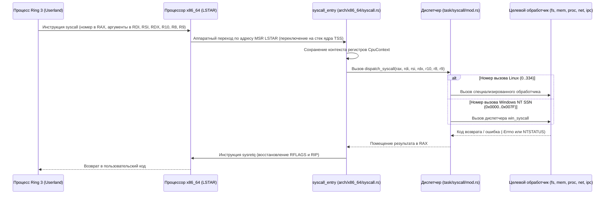

[ 🇷🇺 Русский ](syscalls.ru.md) | [ 🇬🇧 English ](syscalls.en.md)

# Системные вызовы ядра Wunix (System Calls & Dual ABI)

Архитектура системных вызовов **Wunix Core** реализует уникальный двухкомпонентный интерфейс (Dual ABI) пользовательского режима: ядро нативно обрабатывает системные вызовы стандартов **Linux / POSIX**, а также обеспечивает совместимость с системными номерами служб (SSN) подсистемы **Windows NT**.

---

## 1. Аппаратный механизм переключения (x86_64 Syscall Gateway)

Переход из пользовательского режима (Ring 3, DPL=3) в пространство ядра (Ring 0, DPL=0) выполняется с использованием аппаратной инструкции x86_64 `syscall`:

### Соглашение о передаче аргументов (Calling Convention):
- **Номер системного вызова**: регистр `RAX`.
- **Аргументы (до 6 параметров)**: `RDI` (1), `RSI` (2), `RDX` (3), `R10` (4), `R8` (5), `R9` (6).
- **Результат**: регистр `RAX`. Успешные операции возвращают `0` или положительное число; ошибки возвращают отрицательный код `-Errno` (для Linux ABI) или `NTSTATUS` (для NT ABI).
- **Безопасность указателей**: все входящие адреса проверяются функцией `validate_user_ptr`. Адреса выше границы канонического пространства пользователя `0x0000_7FFF_FFFF_FFFF` немедленно отклоняются с ошибкой `-EFAULT`.

---

## 2. Системные вызовы Linux & POSIX ABI

Диспетчер вызовов Linux разделен по модулям Single Responsibility Principle (SRP) в каталоге `kernel/src/task/syscall/`:

### 2.1. Файловые операции и ввод-вывод (`syscall/fs.rs`)
| Сисколл | Номер | Сигнатура | Назначение |
|:---|:---:|:---|:---|
| `sys_read` | `0` | `fd, buf, count` | Читает данные из открытого файла, терминала, сокета или пайпа в буфер процесса. |
| `sys_write` | `1` | `fd, buf, count` | Записывает данные в файл или выводит текст в консоль с парсингом ANSI-цветов. |
| `sys_open` | `2` | `filename, flags, mode` | Открывает существующий файл или создает новый по указанному пути. |
| `sys_close` | `3` | `fd` | Закрывает файловый дескриптор и освобождает ресурс ядра. |
| `sys_stat` | `4` | `filename, statbuf` | Возвращает метаданные файла по пути с переходом по символическим ссылкам. |
| `sys_fstat` | `5` | `fd, statbuf` | Возвращает метаданные файла по открытому файловому дескриптору. |
| `sys_lstat` | `6` | `filename, statbuf` | Возвращает метаданные самого симлинка без перехода по ссылке. |
| `sys_lseek` | `8` | `fd, offset, whence` | Перемещает позицию курсора чтения/записи (`SEEK_SET`, `SEEK_CUR`, `SEEK_END`). |
| `sys_ioctl` | `16` | `fd, cmd, arg` | Управляет параметрами устройств (например, чтение геометрии окна терминала `TIOCGWINSZ`). |
| `sys_pread64` | `17` | `fd, buf, count, pos` | Читает данные по фиксированному смещению без сдвига общего файлового курсора. |
| `sys_pwrite64` | `18` | `fd, buf, count, pos` | Записывает данные по фиксированному смещению без изменения файлового курсора. |
| `sys_readv` | `19` | `fd, iov, iovcnt` | Векторное чтение данных сразу в несколько несмежных пользовательских буферов. |
| `sys_writev` | `20` | `fd, iov, iovcnt` | Векторная запись данных из нескольких буферов в один выходной поток. |
| `sys_access` | `21` | `filename, mode` | Проверяет права доступа к файлу (`R_OK`, `W_OK`, `X_OK`, `F_OK`). |
| `sys_dup` | `32` | `oldfd` | Дублирует файловый дескриптор в первый свободный номер в таблице `FdTable`. |
| `sys_dup2` | `33` | `oldfd, newfd` | Дублирует дескриптор в конкретный целевой номер `newfd`. |
| `sys_dup3` | `292` | `oldfd, newfd, flags` | Дублирует дескриптор с атомарной установкой флага `O_CLOEXEC`. |
| `sys_fcntl` | `72` | `fd, cmd, arg` | Управляет свойствами дескриптора (включение неблокирующего режима `O_NONBLOCK`). |
| `sys_truncate` | `76` | `path, length` | Усекает или расширяет файл по пути до заданного размера. |
| `sys_ftruncate` | `77` | `fd, length` | Изменяет размер открытого файла по его дескриптору. |
| `sys_sync` | `162` | — | Сбрасывает энергонезависимые кэши VFS на постоянный накопитель (`virtio-blk`). |
| `sys_mount` | `165` | `dev, dir, type, flags, data` | Монтирует файловую систему (FAT32, RamFS) в выбранную точку дерева VFS. |
| `sys_umount2` | `166` | `target, flags` | Отмонтирует файловую систему из VFS. |
| `sys_openat` | `257` | `dirfd, path, flags, mode` | Открывает файл относительно переданного каталога `dirfd` или `AT_FDCWD`. |
| `sys_newfstatat` | `262` | `dirfd, path, statbuf, flags` | Получает метаданные файла по относительному или абсолютному пути. |

### 2.2. Навигация и управление директориями (`syscall/dir.rs`)
| Сисколл | Номер | Сигнатура | Назначение |
|:---|:---:|:---|:---|
| `sys_getcwd` | `79` | `buf, size` | Возвращает канонический путь к текущей рабочей директории процесса. |
| `sys_chdir` | `80` | `path` | Меняет рабочую директорию (поддерживает пути Unix и диски Windows `C:\...`). |
| `sys_rename` | `82` | `oldname, newname` | Переименовывает или перемещает файл/каталог в дереве VFS. |
| `sys_mkdir` | `83` | `pathname, mode` | Создает новую директорию в файловой системе. |
| `sys_rmdir` | `84` | `pathname` | Удаляет пустую директорию. |
| `sys_unlink` | `87` | `pathname` | Удаляет файл из файловой системы. |
| `sys_symlink` | `88` | `target, linkpath` | Создает символическую ссылку на файл или директорию. |
| `sys_readlink` | `89` | `path, buf, bufsiz` | Считывает целевой путь назначения символической ссылки. |
| `sys_statfs` | `137` | `path, buf` | Возвращает статистику файловой системы (размер блока, свободное место). |
| `sys_getdents64` | `217` | `fd, dirp, count` | Читает записи каталога (имена файлов, типы) для утилит `ls` и шелла `wsh`. |

### 2.3. Память и адресное пространство (`syscall/mem.rs`)
| Сисколл | Номер | Сигнатура | Назначение |
|:---|:---:|:---|:---|
| `sys_mmap` | `9` | `addr, len, prot, flags, fd, off` | Выделяет диапазон страниц виртуальной памяти (анонимная память или проекция файла). |
| `sys_mprotect` | `10` | `addr, len, prot` | Изменяет права доступа страниц (чтение, запись, исполнение: `PROT_READ`, `PROT_WRITE`). |
| `sys_munmap` | `11` | `addr, len` | Освобождает диапазон страниц виртуальной памяти и сбрасывает TLB. |
| `sys_brk` | `12` | `brk` | Управляет верхней границей кучи процесса для поддержки классического `malloc`. |
| `sys_mincore` | `27` | `start, len, vec` | Проверяет нахождение страниц памяти в физической RAM. |
| `sys_madvise` | `28` | `start, len_in, advice` | Передает ядру подсказку о схеме использования памяти процессом. |

### 2.4. Процессы, потоки и планирование (`syscall/proc.rs`, `syscall/mod.rs`)
| Сисколл | Номер | Сигнатура | Назначение |
|:---|:---:|:---|:---|
| `sys_yield` | `24` | — | Кооперативно уступает квант времени другим потокам в очереди планировщика. |
| `sys_nanosleep` | `35` | `req, rem` | Приостанавливает выполнение текущего потока на заданный интервал времени. |
| `sys_getpid` | `39` | — | Возвращает идентификатор текущего процесса (PID / TGID). |
| `sys_clone` | `56` | `flags, stack, ptid, ctid, tls` | Создает новый поток с общим адресным пространством и индивидуальным TLS. |
| `sys_execve` | `59` | `filename, argv, envp` | Загружает и запускает бинарный образ ELF64 или PE32+ поверх текущего процесса. |
| `sys_exit` | `60` | `error_code` | Завершает выполнение текущего потока с кодом возврата. |
| `sys_wait4` | `61` | `pid, stat_loc, options, rusage` | Ожидает завершения дочернего процесса и получает код его выхода. |
| `sys_kill` | `62` | `pid, sig` | Отправляет сигнал процессу (например, прерывание задачи по `SIGINT`). |
| `sys_uname` | `63` | `buf` | Возвращает системные метаданные (название "Wunix", версия ядра, архитектура). |
| `sys_gettimeofday` | `96` | `tv, tz` | Возвращает текущее время UTC с микросекундной точностью. |
| `sys_sysinfo` | `99` | `info` | Возвращает время работы системы (uptime), общий и свободный объем RAM. |
| `sys_syslog` | `103` | `type, bufp, len` | Читает кольцевой буфер сообщений ядра для системной утилиты `dmesg`. |
| `sys_arch_prctl` | `158` | `code, addr` | Конфигурирует процессорный регистр `FS_BASE` для поддержки TLS. |
| `sys_settimeofday` | `164` | `tv, tz` | Корректирует системные часы ядра и энергонезависимые часы CMOS RTC. |
| `sys_reboot` | `169` | `magic1, magic2, cmd, arg` | Перезагружает ОС или отключает питание компьютера через ACPI. |
| `sys_gettid` | `186` | — | Возвращает уникальный числовой идентификатор текущего потока (`ThreadId`). |
| `sys_sched_getaffinity`| `204`| `pid, cpusetsize, mask` | Возвращает битовую маску доступных ядер процессора (SMP). |
| `sys_set_tid_address` | `218` | `tidptr` | Регистрирует адрес futex, сбрасываемый ядром при завершении потока. |
| `sys_clock_settime` | `227` | `which_clock, tp` | Устанавливает системные часы реального времени. |
| `sys_clock_gettime` | `228` | `which_clock, tp` | Читает часы высокого разрешения (`CLOCK_MONOTONIC`, `CLOCK_REALTIME`). |
| `sys_exit_group` | `231` | `status` | Завершает выполнение всех потоков текущего процесса. |
| `sys_tgkill` | `234` | `tgid, tid, sig` | Отправляет сигнал конкретному потоку внутри группы процессов. |
| `sys_getrandom` | `318` | `buf, buflen, flags` | Генерирует криптографически стойкие псевдослучайные числа из энтропии ядра. |
| `sys_rseq` | `334` | — | Заглушка Restartable Sequences (возврат `-ENOSYS` для перехода libc на TLS). |

### 2.5. Учетные записи и права доступа (`syscall/creds.rs`)
| Сисколл | Номер | Сигнатура | Назначение |
|:---|:---:|:---|:---|
| `sys_chmod` | `90` | `filename, mode` | Изменяет маску прав доступа (`rwx`) к файлу по пути. |
| `sys_fchmod` | `91` | `fd, mode` | Изменяет права доступа для открытого дескриптора. |
| `sys_chown` | `92` | `filename, user, group` | Назначает файлу нового владельца и группу (UID/GID). |
| `sys_fchown` | `93` | `fd, user, group` | Изменяет владельца и группу открытого файла. |
| `sys_umask` | `95` | `mask` | Задает маску прав по умолчанию при создании новых файлов (обычно `022`). |
| `sys_getuid` | `102` | — | Возвращает реальный идентификатор пользователя (UID). |
| `sys_getgid` | `104` | — | Возвращает реальный идентификатор группы (GID). |
| `sys_setuid` | `105` | `uid` | Устанавливает UID пользователя (для утилит `su`, `login`). |
| `sys_setgid` | `106` | `gid` | Устанавливает GID процесса. |
| `sys_geteuid` | `107` | — | Возвращает эффективный UID, определяющий реальные права задачи. |
| `sys_getegid` | `108` | — | Возвращает эффективный GID процесса. |
| `sys_setpgid` | `109` | `pid, pgid` | Назначает группу процессов (управление заданиями в WSH). |
| `sys_getppid` | `110` | — | Возвращает идентификатор родительского процесса (PPID). |
| `sys_getpgrp` | `111` | — | Возвращает группу процессов текущей задачи. |
| `sys_setsid` | `112` | — | Создает новую терминальную сессию и делает процесс ее лидером. |
| `sys_getpgid` | `121` | `pid` | Получает идентификатор группы процессов по указанному PID. |
| `sys_prlimit64` | `302` | `pid, resource, new_limit, old_limit` | Управляет ограничениями ресурсов (макс. открытые файлы, размер стека). |

### 2.6. Межпроцессное взаимодействие (IPC) и события (`syscall/ipc.rs`, `futex.rs`)
| Сисколл | Номер | Сигнатура | Назначение |
|:---|:---:|:---|:---|
| `sys_pipe` | `22` | `filedes` | Создает классический однонаправленный канал данных (пайп). |
| `sys_futex` | `202` | `uaddr, op, val, utime, uaddr2, val3` | Быстрые блокировки пользовательского пространства (`FUTEX_WAIT`, `FUTEX_WAKE`). |
| `sys_epoll_create` | `213` | `size` | Создает экземпляр реактора событий epoll. |
| `sys_epoll_ctl` | `233` | `epfd, op, fd, event` | Регистрирует, модифицирует или удаляет отслеживаемые дескрипторы в epoll. |
| `sys_epoll_wait` | `232` | `epfd, events, maxevents, timeout` | Блокирует поток до появления готовности ввода-вывода в дескрипторах. |
| `sys_epoll_pwait` | `281` | `epfd, events, maxevents, timeout, sigmask` | Ожидает событий epoll с атомарной подменой маски сигналов. |
| `sys_eventfd` | `284` | `initval` | Создает дескриптор счетчика событий для межпоточной синхронизации. |
| `sys_eventfd2` | `290` | `initval, flags` | Создает `eventfd` с флагами неблокирующего режима `EFD_NONBLOCK`. |
| `sys_epoll_create1` | `291` | `flags` | Создает реактор epoll с флагом `EPOLL_CLOEXEC`. |
| `sys_pipe2` | `293` | `filedes, flags` | Создает безымянный пайп с флагами `O_NONBLOCK` и `O_CLOEXEC`. |

### 2.7. Сетевой сокетный интерфейс (`syscall/net.rs`)
| Сисколл | Номер | Сигнатура | Назначение |
|:---|:---:|:---|:---|
| `sys_socket` | `41` | `family, type, protocol` | Создает сокет (`AF_INET`, `SOCK_STREAM` TCP, `SOCK_DGRAM` UDP, `SOCK_RAW` ICMP). |
| `sys_connect` | `42` | `fd, uservaddr, addrlen` | Устанавливает исходящее сетевое соединение с удаленным адресом и портом. |
| `sys_accept` | `43` | `fd, upeer_sockaddr, upeer_addrlen` | Принимает входящее клиентское TCP-соединение. |
| `sys_accept4` | `288` | `fd, upeer_sockaddr, upeer_addrlen, flags` | Принимает подключение с флагами `SOCK_NONBLOCK` и `SOCK_CLOEXEC`. |
| `sys_sendto` | `44` | `fd, buf, len, flags, addr, addr_len` | Отправляет сетевой пакет (поток TCP или датаграмму UDP/ICMP по адресу). |
| `sys_recvfrom` | `45` | `fd, buf, size, flags, addr, addr_len` | Принимает данные из сети с возможностью извлечь адрес отправителя. |
| `sys_sendmsg` | `46` | `fd, msg, flags` | Передает составное сетевое сообщение через структуру `msghdr`. |
| `sys_recvmsg` | `47` | `fd, msg, flags` | Принимает составное сетевое сообщение через структуру `msghdr`. |
| `sys_shutdown` | `48` | `fd, how` | Закрывает сетевой сокет на чтение, запись или в обоих направлениях. |
| `sys_bind` | `49` | `fd, umyaddr, addrlen` | Привязывает сокет к локальному IP-адресу и порту сервера. |
| `sys_listen` | `50` | `fd, backlog` | Переводит сокет в режим прослушивания входящих соединений. |
| `sys_getsockname` | `51` | `fd, usockaddr, uaddrlen` | Возвращает локальный адрес и порт, к которому привязан сокет. |
| `sys_getpeername` | `52` | `fd, usockaddr, uaddrlen` | Возвращает адрес и порт удаленного конца соединения. |
| `sys_setsockopt` | `54` | `fd, level, optname, optval, optlen` | Задает опции сокета (`SO_REUSEADDR`, таймауты приема/передачи). |
| `sys_getsockopt` | `55` | `fd, level, optname, optval, optlen` | Считывает текущие параметры сетевого сокета. |

### 2.8. Сигналы и мультиплексирование (`syscall/poll.rs`, `signal.rs`)
| Сисколл | Номер | Сигнатура | Назначение |
|:---|:---:|:---|:---|
| `sys_poll` | `7` | `ufds, nfds, timeout_msecs` | Опрашивает список дескрипторов и ждет их готовности к вводу-выводу. |
| `sys_select` | `23` | `n, inp, outp, exp, tvp` | Мультиплексирует ввод-вывод по трем битовым маскам дескрипторов. |
| `sys_rt_sigaction` | `13` | `sig, act, oact, sigsetsize` | Назначает функцию-обработчик сигналов POSIX (`SIGINT`, `SIGTERM` и др.). |
| `sys_rt_sigprocmask`| `14` | `how, nset, oset, sigsetsize` | Блокирует или разблокирует доставку сигналов текущему потоку. |
| `sys_rt_sigreturn` | `15` | — | Восстанавливает регистры процессора после возврата из обработчика сигнала. |
| `sys_sigaltstack` | `131` | `uss, uoss` | Назначает альтернативный стек для безопасной обработки сигналов. |

---

## 3. Системные вызовы Windows NT ABI

Обработчики вызовов подсистемы Windows NT сосредоточены в модуле `kernel/src/task/win_syscall/`:

| Вызов NT | SSN | Модуль | Назначение |
|:---|:---:|:---|:---|
| `NtCreateFile` | `0x0012` | `win_syscall/file.rs` | Создает или открывает файл с трансляцией путей NT (`\??\C:\...` в `/win/drives/c/...`). |
| `NtOpenFile` | `0x000A` | `win_syscall/file.rs` | Открывает существующий файл Windows и возвращает NT-дескриптор. |
| `NtReadFile` | `0x0013` | `win_syscall/mod.rs` | Читает данные из файла и заполняет структуру `IO_STATUS_BLOCK`. |
| `NtWriteFile` | `0x0014` | `win_syscall/mod.rs` | Записывает данные в файл с фиксацией записанных байт в `IoStatus.Information`. |
| `NtClose` | `0x0006` | `win_syscall/mod.rs` | Закрывает дескриптор файла или открытый ключ реестра. |
| `NtQueryInformationFile` | `0x000B` | `win_syscall/file.rs` | Считывает размер файла, временные метки и атрибуты (`FILE_STANDARD_INFORMATION`). |
| `NtAllocateVirtualMemory` | `0x001C` | `win_syscall/mod.rs` | Выделяет страницы виртуальной памяти процесса (поддержка функции `VirtualAlloc`). |
| `NtFreeVirtualMemory` | `0x001D` | `win_syscall/mod.rs` | Освобождает страницы виртуальной памяти процесса (поддержка `VirtualFree`). |
| `NtProtectVirtualMemory` | `0x004D` | `win_syscall/mod.rs` | Изменяет права доступа страниц памяти (`PAGE_READWRITE`, `PAGE_EXECUTE_READ`). |
| `NtYieldExecution` | `0x0008` | `win_syscall/mod.rs` | Передает квант времени планировщику (кооперативное переключение). |
| `NtDelayExecution` | `0x0004` | `win_syscall/mod.rs` | Приостанавливает поток на время `LARGE_INTEGER` (в сотнях наносекунд). |
| `NtWaitForSingleObject` | `0x0003` | `win_syscall/mod.rs` | Ожидает завершения события или операции ввода-вывода с таймаутом. |
| `NtDuplicateObject` | `0x003C` | `win_syscall/mod.rs` | Дублирует дескриптор объекта Windows между процессами. |
| `NtCreateEvent` | `0x007A` | `win_syscall/mod.rs` | Создает объект события синхронизации Windows на базе дескриптора `eventfd`. |
| `NtDeviceIoControlFile` | `0x0002` | `win_syscall/file.rs` | Передает команду IOCTL драйверу устройства из Windows-приложения. |
| `NtCreateThread` | `0x0041` | `win_syscall/mod.rs` | Создает новый поток выполнения Windows NT. |
| `NtTerminateProcess` | `0x0072` | `win_syscall/mod.rs` | Завершает выполнение процесса Windows и возвращает статус выхода. |
| `NtQueryInformationProcess` | `0x0007` | `win_syscall/file.rs` | Возвращает данные о процессе (PID, адрес блока окружения PEB). |
| `NtQuerySystemInformation` | `0x0028` | `win_syscall/file.rs` | Возвращает данные об установленной памяти, времени работы и версии ядра. |
| `NtOpenKey` | `0x0055` | `win_syscall/registry.rs` | Открывает раздел реестра (транслирует путь в `/win/registry/`). |
| `NtCreateKey` | `0x0050` | `win_syscall/registry.rs` | Создает новый раздел в иерархическом реестре Windows NT. |
| `NtQueryValueKey` | `0x0057` | `win_syscall/registry.rs` | Читает строковый, числовой или бинарный параметр ключа реестра. |
| `NtSetValueKey` | `0x0058` | `win_syscall/registry.rs` | Записывает или модифицирует значение параметра в реестре. |
| `NtEnumerateKey` | `0x005F` | `win_syscall/registry.rs` | Перечисляет список подразделов реестра по числовому индексу. |
| `NtDeleteValueKey` | `0x006E` | `win_syscall/registry.rs` | Удаляет именованный параметр из раздела реестра. |

---

## 4. Дорожная карта расширения системных вызовов (TODO)

### 4.1. Запланированные вызовы Linux / POSIX:
1. `sys_fork` (`57`): Создание точной копии процесса с дублированием таблиц страниц памяти через механизм Copy-On-Write (COW).
2. `sys_sendfile` (`40`): Прямая передача данных из дескриптора файла в сетевой сокет внутри ядра без накладных копирований в Ring 3.
3. `sys_splice` (`275`): Перемещение данных между каналом (пайпом) и файлом без копирования через пользовательскую память (zero-copy).
4. `sys_mremap` (`25`): Динамическое расширение или перемещение ранее выделенной области виртуальной памяти.
5. `sys_timerfd_create` (`283`): Создание таймера в виде файлового дескриптора для прямой интеграции в событийный цикл `epoll`.
6. `sys_signalfd4` (`289`): Чтение входящих сигналов потока как стандартных данных из дескриптора.
7. `sys_ptrace` (`101`): Интерфейс инспектирования регистров и памяти процессов для отладчиков (`gdb`, `strace`).

### 4.2. Запланированные вызовы Windows NT:
1. `NtCreateSection` / `NtMapViewOfSection` / `NtUnmapViewOfSection`: Создание и проецирование секций разделяемой памяти (необходимо для загрузки динамических библиотек DLL).
2. `NtQueryDirectoryFile`: Перечисление содержимого директорий в структурированном NT-формате `FILE_DIRECTORY_INFORMATION`.
3. `NtQueueApcThread`: Постановка асинхронного вызова процедуры (APC) в очередь потока.
4. `NtCreateMutant`: Создание системных именованных мьютексов Windows для межпроцессной синхронизации.
5. `NtCreateNamedPipeFile`: Создание именованных каналов IPC (`\\.\pipe\...`).
