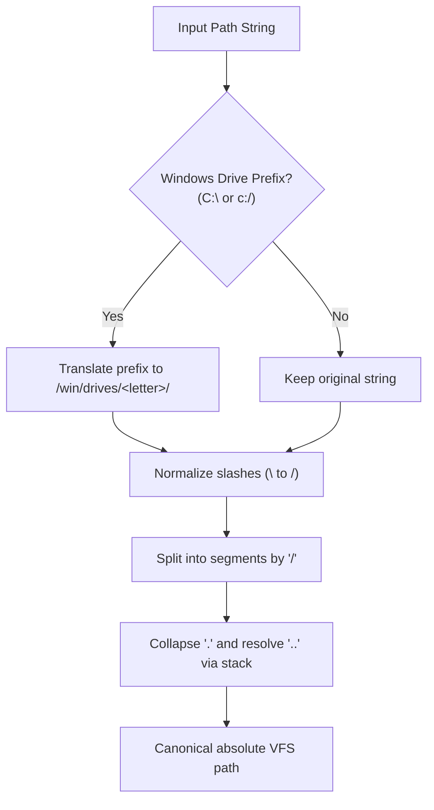
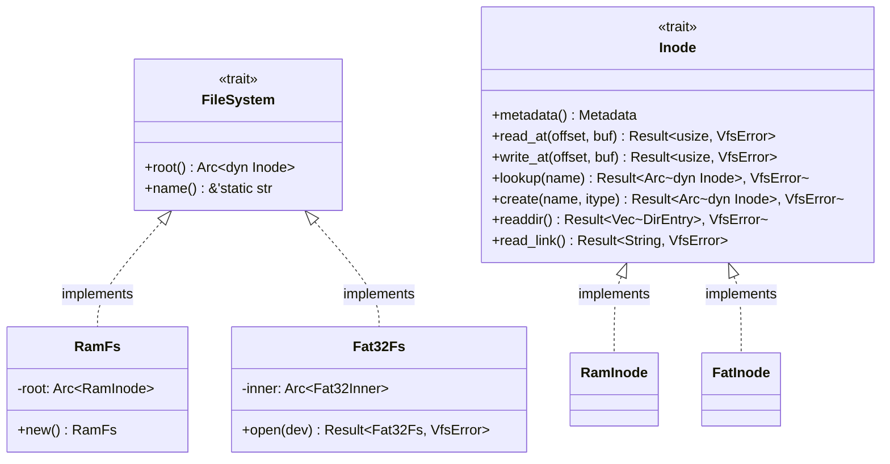

[ 🇷🇺 Русский ](vfs.ru.md) | [ 🇬🇧 English ](vfs.en.md)

# Virtual File System (VFS) and Hybrid Path Architecture

The Virtual File System (**VFS**) in Wunix unifies two fundamentally distinct operating system paradigms — the classic **UNIX** directory hierarchy and the **Windows NT** object-drive storage model — inside a single, type-safe monolithic kernel namespace implemented in Rust.

---

## 1. Hybrid Monolithic Tree Concept

In traditional hybrid environments (such as WSL or Wine), interoperability is achieved through lightweight virtualization or user-space system call translation with path emulation layers. In Wunix, hybrid capabilities are embedded **directly into the kernel core**:

1. **Unified Root (`/`)**: The entire filesystem forms a single directed graph of Inodes starting at `/`.
2. **Parallel Subsystem Coexistence**:
   - The standard POSIX hierarchy (`/bin`, `/sbin`, `/etc`, `/dev`, `/home`, `/proc`, `/sys`, `/mnt`, `/tmp`, `/var`) serves native UNIX daemons, standard I/O streams, and command-line utilities.
   - The isolated NT subsystem tree (`/win/drives/c/`, `/win/registry/`) provides a native habitat for ported Windows binaries, registry hives, and NT Object Manager semantics.
3. **Absence of Discrete Drive Letters in the Kernel Core**: Windows drive letters (`C:`, `D:`) are treated as syntactic representations, transparently translated by the VFS into mount points under `/win/drives/<drive>/`.

```
/ (VFS Root)
├── bin/                       # Native Wunix core utilities
├── dev/                       # Character and block devices (vda, vda1, tty, null, zero)
├── etc/                       # System configuration files (os-release, hostname, locale)
├── home/                      # User home directories
│   └── user/                  # Current user profile (/home/user)
├── mnt/                       # Persistent disk mount target (FAT32 /dev/vda1)
├── proc/                      # Process and kernel diagnostics pseudo-fs (uptime, meminfo, mounts)
├── sys/                       # Device and bus topology (devices/pci)
├── tmp/                       # Temporary files directory
└── win/                       # Windows NT subsystem namespace
    ├── drives/
    │   └── c/                 # Projection of drive C:\
    │       ├── Program Files/
    │       ├── Users/
    │       │   └── user ────► [Symbolic link to /home/user]
    │       └── Windows/System32/
    └── registry/              # Windows NT registry hives (SYSTEM, SOFTWARE)
```

---

## 2. Path Translation and Resolution Rules

All kernel I/O operations (`vfs::open`, `vfs::read_file`, `vfs::write_file`, `vfs::mkdir_p`) accept arbitrary path string encodings (POSIX or Windows notation) and normalize them via [`fs/path.rs`](file:///home/valdis/my-os/wunix/kernel/src/fs/path.rs).

### 2.1. Translation Algorithm (`translate_path`)



1. **Windows Drive Detection**: Paths starting with a Latin drive letter and a colon (`C:` or `c:`) are converted to `/win/drives/<drive_letter>/`, with the drive letter always mapped to lowercase.
2. **Slash Normalization**: Backslashes `\` are normalized to standard forward slashes `/`.
3. **Relative Segment Resolution (`normalize_path`)**:
   - Redundant slashes and single dot `.` segments are ignored.
   - `..` transitions pop the top component from the path stack.
   - Traversals cannot escape the VFS root: invoking `..` at `/` retains `/`.

### 2.2. Normalization Examples

| Input Path | Canonical VFS Path | Notes |
|---|---|---|
| `C:\Windows\System32\drivers` | `/win/drives/c/Windows/System32/drivers` | Drive letter translation and slash conversion |
| `c:/windows/../program files` | `/win/drives/c/program files` | Segment resolution for `..` |
| `C:` | `/win/drives/c` | Volume root directory |
| `\\server\share\file` | `/server/share/file` | Network UNC prefixes mapped to VFS tree |
| `/etc/../etc/os-release` | `/etc/os-release` | Native POSIX path |

### 2.3. Case-Insensitive Lookup in the NT Subsystem

UNIX filesystems are case-sensitive, whereas Win32 and the NT Object Manager require case-insensitivity: opening `c:\windows\system32` must resolve the directory `System32`.

Wunix solves this per-directory without global penalties:
1. `is_windows_subsystem(path)` flags paths falling into `/win` or `/win/...`.
2. When calling `Inode::lookup(name)`:
   - An exact lookup is first performed in `BTreeMap` in $O(\log N)$ time.
   - If not found, and the directory is marked `case_insensitive` (or resides within `/win`), entries are iterated comparing with `key.eq_ignore_ascii_case(name)`.
3. Directories created under `/win` automatically inherit `case_insensitive = true`.

### 2.4. Symbolic Link Traversal

`resolve_path(path, follow_last_symlink)` navigates segments iteratively:
- When encountering an `InodeType::Symlink`, the target is read via `read_link()`.
- Relative links are appended to the parent directory; absolute links restart traversal from `/`.
- **Loop Protection**: Symlink chain depth is strictly capped at 16 (`symlink_depth > 16`), returning `VfsError::InvalidPath` on overflow.

---

## 3. Unified User Profile

A chronic issue in hybrid operating systems is data fragmentation between independent user accounts.

Wunix solves this by establishing a **single unified user profile**:
- The canonical storage directory is `/home/user`.
- During VFS boot initialization, the kernel constructs `/win/drives/c/Users` and links:
  ```
  /win/drives/c/Users/user  ───(Symlink)───►  /home/user
  ```
- Any Win32 application reading `C:\Users\user\Documents` seamlessly accesses `/home/user/Documents`. POSIX utilities interact with identical files without path conversions.

---

## 4. VFS Type Hierarchy and Abstractions

VFS traits reside in [`fs/vfs.rs`](file:///home/valdis/my-os/wunix/kernel/src/fs/vfs.rs):



### 4.1. The `Inode` Trait

All VFS objects (files, directories, symlinks, character/block devices) implement `Inode`:

```rust
pub trait Inode: Send + Sync {
    fn metadata(&self) -> Metadata;
    fn read_at(&self, offset: usize, buf: &mut [u8]) -> Result<usize, VfsError>;
    fn write_at(&self, offset: usize, buf: &[u8]) -> Result<usize, VfsError>;
    fn lookup(&self, name: &str) -> Result<Arc<dyn Inode>, VfsError>;
    fn create(&self, name: &str, itype: InodeType) -> Result<Arc<dyn Inode>, VfsError>;
    fn readdir(&self) -> Result<Vec<DirEntry>, VfsError>;
    fn read_link(&self) -> Result<String, VfsError>;
}
```

- Requiring `Send + Sync` ensures thread-safe sharing across kernel threads and interrupt handlers.
- Safe default implementations return `Err(VfsError::NotADirectory)` or `Err(VfsError::NotSupported)`.

### 4.2. Metadata and Error Model

- `InodeType`: Typed enumeration of filesystem node categories (`File`, `Directory`, `Symlink`, `CharDevice`, `BlockDevice`).
- `Metadata`: Node properties (type, size in bytes, unique `inode_id`, POSIX octal `permissions`).
- `DirEntry`: Directory listing entry (`name`, `inode_id`, `itype`).
- `VfsError`: Exhaustive enumeration of filesystem errors:
  - `NotFound`, `IsADirectory`, `NotADirectory`, `PermissionDenied`, `AlreadyExists`, `InvalidPath`, `IoError`, `NotSupported`.

---

## 5. File Descriptors and the `FileHandle` Trait

In line with the UNIX "Everything is a file" model, [`fs/handle.rs`](file:///home/valdis/my-os/wunix/kernel/src/fs/handle.rs) and [`fs/fd.rs`](file:///home/valdis/my-os/wunix/kernel/src/fs/fd.rs) provide a uniform open resource abstraction:

```rust
pub trait FileHandle: Send + Sync {
    fn read(&self, buf: &mut [u8]) -> Result<usize, i64>;
    fn write(&self, buf: &[u8]) -> Result<usize, i64>;
    fn poll_events(&self) -> u32;
    fn get_flags(&self) -> u32;
    fn set_flags(&self, flags: u32);
    fn close(&self);
    fn as_inode(&self) -> Option<Arc<dyn Inode>>;
    fn offset(&self) -> usize;
    fn set_offset(&self, offset: usize);
    fn epoll_ctl(&self, op: u32, fd: u64, event_ptr: u64) -> Result<u64, i64>;
}
```

### Implementations of `FileHandle`:
1. **`InodeHandle`**: Files and directories with tracking of read/write `offset`.
2. **`StdinHandle` / `StdoutHandle`**: Standard I/O handles connecting keyboard scan codes to terminal framebuffer output with ANSI parser and COM1 serial mirroring.
3. **`PipeHandle`**: IPC unidirectional circular ring buffers powering shell pipelines (`cmd1 | cmd2`).
4. **`SocketHandle`**: TCP/UDP/ICMP network sockets bridging `read`/`write` directly to `smoltcp`.
5. **`EventFdHandle`**: Inter-thread 64-bit event counters.
6. **`EpollHandle`**: Asynchronous I/O event readiness multiplexers.

---

## 6. Block Storage Layer and FAT32 Driver

For persistent storage on real drives and virtual block images, Wunix implements a complete block stack:

### 6.1. Block Devices and MBR Partitions (`fs/block.rs`)
- The `BlockDevice` trait provides synchronous 512-byte sector operations (`read_sectors`, `write_sectors`).
- When a block storage controller (`virtio-blk`) is detected on the PCI bus, device `/dev/vda` is registered.
- Sector 0 is parsed for Master Boot Record (MBR) partition tables, automatically creating partition devices such as `/dev/vda1`.

### 6.2. FAT32 Filesystem Driver (`fs/fat.rs`)
- **BPB Parsing**: Reads BIOS Parameter Block parameters from partition sector 0: bytes per sector, sectors per cluster, reserved sectors, number of FAT copies, and root directory cluster.
- **Cluster Chains**: Files are retrieved by traversing FAT32 entries until the end-of-chain marker `FAT32_EOC` (`0x0FFF_FFFF`).
- **Sector Caching**: Directory and FAT sectors are cached in memory to minimize storage bus latency.
- **Long File Name (LFN) Support**: Handles standard 8.3 short names and UTF-16 LFN directory records.

---

## 7. Dynamic Mount Management (`fs/mount.rs`)

The kernel maintains an in-memory mount table:
- `sys_mount(source, target, fstype, flags, data)` mounts a block filesystem onto any VFS path.
  - Example: Mounting `/dev/vda1` (FAT32) to `/mnt`.
- `sys_umount2(target, flags)` unmounts filesystems cleanly and flushes dirty metadata.
- Active mount points are exported to `/proc/mounts`.

---

## 8. Diagnostic Pseudo-Filesystems: ProcFS & SysFS

Module [`fs/procfs.rs`](file:///home/valdis/my-os/wunix/kernel/src/fs/procfs.rs) generates synthetic text files on demand:

| Pseudo-file Path | Content Provided | Consumers |
|---|---|---|
| `/proc/uptime` | System uptime in seconds and milliseconds | `top`, `wsh`, `date` |
| `/proc/meminfo` | Total, free, and used memory statistics | `free`, `top` |
| `/proc/cpuinfo` | CPUID model, core count, instruction flags | `lshw`, `uname` |
| `/proc/version` | Kernel version and build timestamp | `uname`, `dmesg` |
| `/proc/mounts` | Active filesystem mount points table | `mount`, `df`, `lsblk` |
| `/proc/net/dev` | Network interface TX/RX packet statistics | `ip`, `ss` |
| `/sys/devices/pci` | Enumerated PCI devices and drivers | `lspci`, `lshw` |

---

## 9. Windows NT Virtual Registry (`fs/registry/`)

Compatibility with ported Windows applications and NT system parameters is supported via `/win/registry/`:

- **Registry Hives**:
  - `HKEY_LOCAL_MACHINE\SYSTEM` $\to$ `/win/registry/SYSTEM`
  - `HKEY_LOCAL_MACHINE\SOFTWARE` $\to$ `/win/registry/SOFTWARE`
- **Value Types**:
  - `REG_SZ`: String values (versions, driver names, system paths).
  - `REG_DWORD`: 32-bit integer values (timeouts, operational flags).
  - `REG_BINARY`: Binary configuration blobs.
- Manipulated via Windows NT syscalls (`NtOpenKey`, `NtCreateKey`, `NtQueryValueKey`) and the `reg` CLI utility.

---

## 10. Storage Subsystem Roadmap

1. **Stage 1 (Completed)**: Core VFS traits (`Inode`, `FileSystem`), in-memory RamFS, Windows path translation, POSIX ustar initramfs parser, and root mount.
2. **Stage 2 (Completed)**: Block storage layer `BlockDevice` (`/dev/vda`), MBR partition parser (`/dev/vda1`), **FAT32** filesystem driver with sector caching, dynamic `mount`/`umount2` system calls, ProcFS/SysFS synthetic filesystems, and the Windows NT registry.
3. **Stage 3 (In Development)**: **EXT2/EXT4** filesystem driver for persistent Linux root partitions.
4. **Stage 4 (Planned)**: Unified Page Cache with asynchronous write-back and disk sync.
