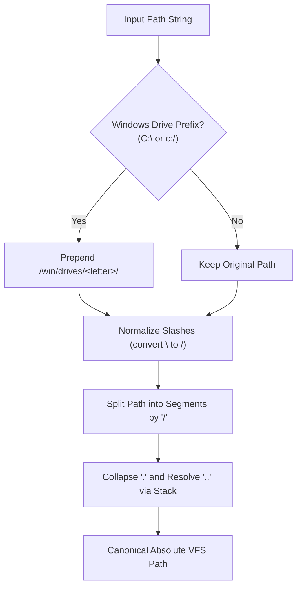
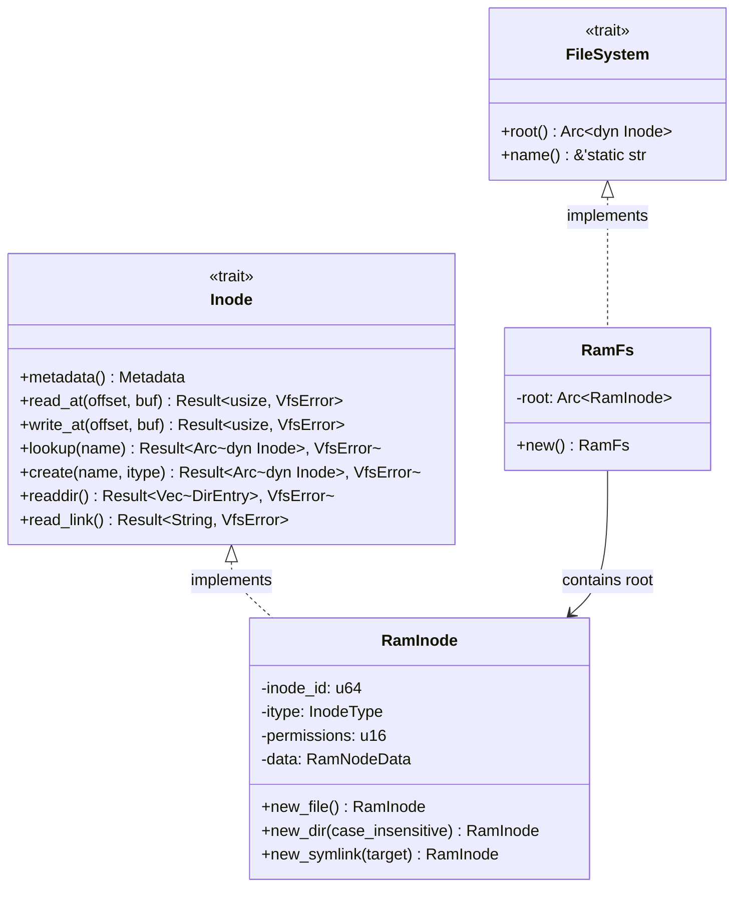
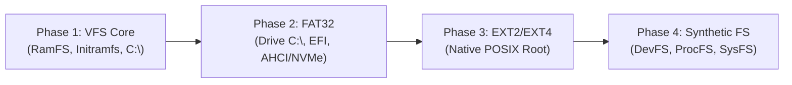

[ 🇷🇺 Русский ](vfs.ru.md) | [ 🇬🇧 English ](vfs.en.md)

# Virtual File System (VFS) and Hybrid Path Architecture

The Virtual File System (**VFS**) in Wunix unifies two fundamentally distinct operating system paradigms — the classic **UNIX** directory hierarchy and the **Windows NT** object-drive storage model — inside a single, type-safe monolithic kernel namespace implemented in Rust.

---

## 1. Hybrid Monolithic Tree Concept

In traditional hybrid environments (such as WSL or Wine), interoperability is achieved through lightweight virtualization or user-space system call translation with path emulation layers. In Wunix, hybrid capabilities are embedded **directly into the kernel core**:

1. **Unified Root (`/`)**: The entire filesystem forms a single directed graph of Inodes starting at `/`.
2. **Parallel Subsystem Coexistence**:
   - The standard POSIX hierarchy (`/bin`, `/sbin`, `/etc`, `/dev`, `/home`, `/proc`, `/sys`, `/tmp`, `/var`) serves native UNIX daemons, standard I/O streams, and command-line utilities.
   - The isolated NT subsystem tree (`/win/drives/c/`, `/win/registry/`) provides a native habitat for ported Windows binaries, registry hives, and NT Object Manager semantics.
3. **Absence of Discrete Drive Letters in the Kernel Core**: Windows drive letters (`C:`, `D:`) are treated as syntactic representations, transparently translated by the VFS into mount points under `/win/drives/<drive>/`.

```
/ (VFS Root)
├── bin/                       # Native Wunix core utilities
├── dev/                       # Character and block devices (Char/Block Devices)
├── etc/                       # System configuration files (os-release, hostname)
│   ├── hostname
│   └── os-release
├── home/                      # User home directories
│   └── user/                  # Current user profile (/home/user)
│       ├── .wunixrc
│       └── Documents/
├── proc/                      # Process and kernel diagnostics pseudo-fs
├── sys/                       # Device and bus topology
├── tmp/                       # Temporary files directory
└── win/                       # Windows NT subsystem namespace
    ├── drives/
    │   └── c/                 # Projection of drive C:\
    │       ├── Program Files/
    │       ├── Users/
    │       │   └── user ────► [Symbolic link pointing to /home/user]
    │       └── Windows/
    │           ├── System32/
    │           └── system.ini
    └── registry/              # Windows Registry hives (SYSTEM, SOFTWARE)
        └── SYSTEM.reg
```

---

## 2. Path Translation Engine and Resolution Rules

All kernel I/O operations (`vfs::open`, `vfs::read_file`, `vfs::write_file`, `vfs::mkdir_p`) accept arbitrary path strings (both POSIX notation and Windows backslash syntax) and route them through the translation engine in [`fs/path.rs`](file:///home/valdis/my-os/wunix/kernel/src/fs/path.rs).

### 2.1. Translation Algorithm (`translate_path`)



1. **Windows Drive Prefix Detection**: If the path starts with an ASCII letter followed by a colon (e.g., `C:` or `c:`), the prefix is translated into `/win/drives/<drive_letter>/`, with the drive letter converted to lowercase.
2. **Separator Unification**: Backslashes (`\`) are normalized to forward slashes (`/`).
3. **Relative Path Resolution (`normalize_path`)**:
   - Empty elements and single dots (`.`) are ignored;
   - Double dots (`..`) pop the top segment from the path component stack;
   - Root escape prevention: applying `..` at root retains the `/` root.

### 2.2. Normalization Examples

| Input Path | Canonical VFS Path | Description |
|---|---|---|
| `C:\Windows\System32\drivers` | `/win/drives/c/Windows/System32/drivers` | Drive prefix translation and slash normalization |
| `c:/windows/../program files` | `/win/drives/c/program files` | Parent directory traversal resolution (`..`) |
| `C:` | `/win/drives/c` | Drive volume root |
| `\\server\share\file` | `/server/share/file` | UNC network paths flattened into VFS hierarchy |
| `/etc/../etc/os-release` | `/etc/os-release` | Native POSIX path normalization |

### 2.3. Case-Insensitive Lookup in the NT Subsystem

UNIX filesystems are strictly case-sensitive, while Win32 and NT Object Manager expect case-insensitive behavior: querying `c:\windows\system32` must reliably match directory `System32`.

Wunix solves this with granular path routing:
1. `is_windows_subsystem(path)` checks if the normalized path begins with `/win` or `/win/...`.
2. When performing `Inode::lookup(name)`:
   - The directory executes a fast exact match in its `BTreeMap` in $O(\log N)$ time.
   - If no exact match is found and the directory is flagged `case_insensitive` (or the lookup occurs within `/win`), the kernel iterates over directory entries performing `key.eq_ignore_ascii_case(name)`.
3. All child directories created inside `/win` automatically inherit `case_insensitive = true`.

### 2.4. Symbolic Link Resolution

The `resolve_path(path, follow_last_symlink)` routine walks path segments step-by-step:
- If an intermediate node is a symbolic link (`InodeType::Symlink`), the target string is fetched via `read_link()`.
- Relative symlinks are prepended with the current parent directory, while absolute symlinks restart traversal from the root.
- **Loop Prevention**: Traversal depth is bounded to 16 hops (`symlink_depth > 16`). Exceeding this limit returns `VfsError::InvalidPath`.

---

## 3. Seamless User Profile Integration (Unified Profile)

In mixed operating environments, user configurations, documents, and SSH credentials frequently suffer from fragmentation when a "Windows user" and a "Linux user" reside in disparate folder structures.

Wunix enforces a **single user profile** paradigm at the VFS level:
- The authoritative physical storage location for user files is `/home/user`.
- During VFS initialization, the kernel constructs `/win/drives/c/Users` and creates a symbolic link:
  ```
  /win/drives/c/Users/user  ───(Symlink)───►  /home/user
  ```
- Any Win32 application writing to `C:\Users\user\Documents` transparently targets `/home/user/Documents`. POSIX shells and daemons access the same files without path translations or background network synchronizers.

---

## 4. VFS Type Hierarchy and Abstractions

The Wunix VFS is built on Rust traits located in [`fs/vfs.rs`](file:///home/valdis/my-os/wunix/kernel/src/fs/vfs.rs). The core kernel interacts solely with trait objects, decoupling storage layout from file operations.



### 4.1. The `Inode` Trait

Every node in the VFS hierarchy (regular files, directories, symbolic links, character devices, block devices) implements `Inode`:

```rust
pub trait Inode: Send + Sync {
    fn metadata(&self) -> Metadata;
    fn read_at(&self, offset: usize, buf: &mut [u8]) -> Result<usize, VfsError>;
    fn write_at(&self, offset: usize, buf: &[u8]) -> Result<usize, VfsError>;
    fn lookup(&self, name: &str) -> Result<Arc<dyn Inode>, VfsError>;
    fn create(&self, name: &str, itype: InodeType) -> Result<Arc<dyn Inode>, VfsError>;
    fn readdir(&self) -> Result<Vec<DirEntry>, VfsError>;
    fn read_link(&self) -> Result<String, VfsError>;
}
```

- Bound by `Send + Sync`, Inodes can be shared across multiple kernel threads and exception handlers.
- Safe default trait methods return `Err(VfsError::NotADirectory)` or `Err(VfsError::NotSupported)`, avoiding boilerplate stub implementations across specialized file node types.

### 4.2. Metadata and Errors

- `InodeType`: Strongly typed node discriminator (`File`, `Directory`, `Symlink`, `CharDevice`, `BlockDevice`).
- `Metadata`: Node properties including type, byte size, unique `inode_id`, and octal `permissions`.
- `DirEntry`: Directory listing item returned by `readdir()` (`name`, `inode_id`, `itype`).
- `VfsError`: Exhaustive enumeration of filesystem errors:
  - `NotFound`: Node not present;
  - `IsADirectory` / `NotADirectory`: Node type mismatch for requested operation;
  - `PermissionDenied`: Access disallowed by permission mask;
  - `AlreadyExists`: Attempted creation of an existing filename;
  - `InvalidPath`: Malformed path syntax or symlink recursion exceeded;
  - `IoError`: Device I/O failure or allocation error;
  - `NotSupported`: Operation unsupported by filesystem driver.

---

## 5. In-Memory Filesystem (RamFS) Internals

The [`fs/ramfs.rs`](file:///home/valdis/my-os/wunix/kernel/src/fs/ramfs.rs) module provides an in-memory filesystem stored in the dynamic kernel heap. RamFS serves as the initial root filesystem (`/`) during early hardware bring-up before disk block devices are mounted.

### 5.1. Thread-Safe `RamInode` Structure

To eliminate coarse-grained filesystem locks, concurrency controls reside inside each individual node:

```rust
pub enum RamNodeData {
    File(RwLock<Vec<u8>>),
    Directory {
        children: RwLock<BTreeMap<String, Arc<dyn Inode>>>,
        case_insensitive: RwLock<bool>,
    },
    Symlink(RwLock<String>),
}

pub struct RamInode {
    inode_id: u64,
    itype: InodeType,
    permissions: u16,
    data: RamNodeData,
}
```

1. **Regular Files (`File`)**: Payloads are stored inside a dynamic byte vector `Vec<u8>` wrapped by a `spin::RwLock`. Concurrent reads (`read_at`) proceed in parallel; writes (`write_at`) acquire an exclusive lock and automatically grow the backing storage (`data.resize(end, 0)`) when writing past the current file length.
2. **Directories (`Directory`)**: Child references are held in an ordered `BTreeMap<String, Arc<dyn Inode>>`. Storing child nodes as `Arc<dyn Inode>` allows mounting foreign filesystem implementations (such as Ext2, FAT32, or ProcFS) seamlessly into the RamFS tree.
3. **Identifier Generation**: The `inode_id` attribute is assigned via an atomic global counter `static NEXT_INODE_ID: AtomicU64` with `fetch_add(1, Ordering::Relaxed)`.

---

## 6. Initramfs Extraction and Limine Integration

To allow Wunix to boot into a functional userland without requiring AHCI or NVMe storage drivers, essential configuration and binaries are bundled into an in-memory `initramfs.tar` archive delivered by the **Limine** bootloader.

### 6.1. The POSIX ustar Specification

The archive unpacker in [`fs/tar.rs`](file:///home/valdis/my-os/wunix/kernel/src/fs/tar.rs) conforms to the **POSIX IEEE P1003.1 ustar** archive standard. The archive is composed of consecutive 512-byte blocks:

```
┌─────────────────────────────────────────────────────────────┐
│                    512-byte TAR Header                      │
├───────────────┬──────────────┬───────────────┬──────────────┤
│ 0..100: name  │ 100..108:mode│ 108..116: uid │ 116..124: gid│
├───────────────┴──────────────┼───────────────┴──────────────┤
│ 124..136: size (octal ASCII) │ 136..148: mtime (timestamp)  │
├──────────────────────────────┼───────────────┬──────────────┤
│ 148..156: chksum             │ 156: typeflag │157..257: link│
├──────────────────────────────┴───────────────┴──────────────┤
│ 257..263: magic ("ustar\0")  │ 345..500: prefix (path)      │
└──────────────────────────────┴──────────────────────────────┘
│             Payload Data Blocks: ceil(size / 512)           │
└─────────────────────────────────────────────────────────────┘
```

- **File Size (`size`)**: Parsed by `parse_octal` from an octal ASCII string representation;
- **Record Discriminator (`typeflag`)**:
  - `b'0'` or `0`: Regular file;
  - `b'2'`: Symbolic link (target stored in `linkname`);
  - `b'5'`: Directory.
- **Archive Terminator**: Two consecutive zero-filled 512-byte blocks (1024 zero bytes).

### 6.2. Limine Boot Protocol Integration

1. The build harness [`tools/run.sh`](file:///home/valdis/my-os/wunix/tools/run.sh) prepares configuration templates (`/etc/os-release`, `/etc/hostname`, `/win/drives/c/Windows/system.ini`, `/win/registry/SYSTEM.reg`), bundles them via `tar --format=ustar -cf initramfs.tar ...`, and registers them in `limine.conf`:
   ```ini
   module_path: boot():/boot/initramfs.tar
   ```
2. The kernel queries loaded modules via a static `ModuleRequest`:
   ```rust
   #[used]
   #[link_section = ".requests"]
   static MODULE_REQUEST: limine::request::ModuleRequest = limine::request::ModuleRequest::new();
   ```
3. The kernel entry point (`main.rs`) accesses the raw slice `first_module.data()` and passes it to `fs::init(Some(bytes))`.
4. `tar::unpack_tar` extracts files and directories directly into the mounted `RamFs` root, automatically creating any missing intermediate paths (`ensure_dir_path`).

---

## 7. Storage Subsystem Roadmap

Wunix filesystem development proceeds across four distinct phases:



### Phase 1: Core Foundation (Current Milestone)
- [x] Defined `Inode`, `FileSystem`, `Metadata`, and `DirEntry` abstractions;
- [x] Implemented in-memory `RamFs` with thread-safe `RamInode` containers;
- [x] Implemented path engine: `C:\` -> `/win/drives/c/`, `.` and `..` canonicalization;
- [x] Implemented symbolic links and unified user profile (`C:\Users\user` -> `/home/user`);
- [x] Implemented POSIX ustar initramfs unpacker over Limine `ModuleRequest`.

### Phase 2: FAT32 Driver and Persistent Block Storage
- Implement block layer abstractions: `BlockDevice` trait with an integrated Sector Buffer Cache;
- Develop FAT32 driver: parse BPB/EBPB boot records, FAT1/FAT2 allocation tables, cluster chains, and Long File Names (LFN);
- Mount persistent drive `C:\` from a physical FAT32 partition and attach `/boot/efi`.

### Phase 3: Native EXT2 / EXT4 Support
- Implement EXT2/EXT4 filesystem driver for persistent POSIX storage;
- Support block groups, Inode allocation tables, bitmap allocators, indirect blocks, and extents;
- Enforce standard POSIX permission bits (`chown`, `chmod`) and Access Control Lists (ACLs).

### Phase 4: Synthetic Pseudo-Filesystems (DevFS, ProcFS, SysFS)
- **DevFS (`/dev`)**: Dynamic registration of character devices (`/dev/console`, `/dev/serial0`, `/dev/null`) and block storage devices (`/dev/sda`);
- **ProcFS (`/proc`)**: Kernel introspection and scheduler statistics exported as virtual text files (`/proc/cpuinfo`, `/proc/meminfo`, `/proc/<pid>/status`);
- **SysFS (`/sys`)**: Hardware device trees, PCI bus hierarchies, and active kernel driver configurations.
