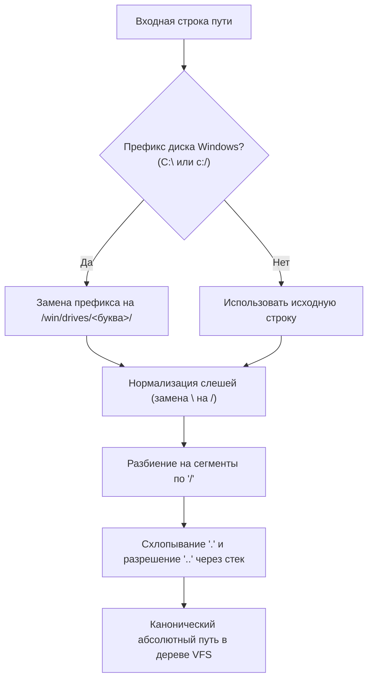
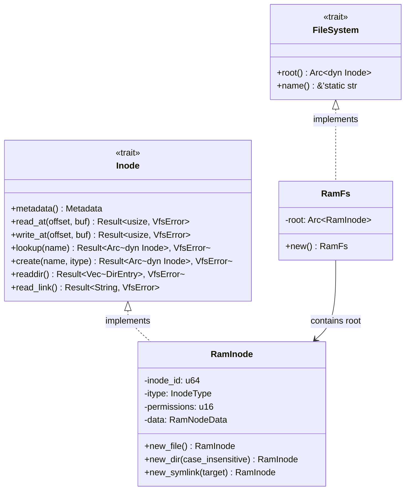
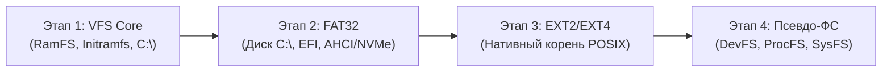

[ 🇷🇺 Русский ](vfs.ru.md) | [ 🇬🇧 English ](vfs.en.md)

# Виртуальная файловая система (VFS) и гибридная архитектура путей

Виртуальная файловая система (**VFS**) операционной системы Wunix решает задачу объединения двух фундаментально различных парадигм проектирования ОС — классической иерархии **UNIX** и объектно-дисковой модели **Windows NT** — внутри единого монолитного дерева ядра на базе абстракций языка Rust.

---

## 1. Концепция гибридного монолитного дерева

В традиционных гибридных средах (например, WSL или Wine) совмещение сред достигается либо запуском легковесной виртуальной машины, либо трансляцией системных вызовов в пользовательском пространстве с эмуляцией путей. В Wunix гибридная архитектура заложена **на уровне самого ядра**:

1. **Единый корень `/`**: вся файловая система представляет собой единое направленное дерево графа Inode.
2. **Параллельное сосуществование пространств**:
   - Стандартная иерархия POSIX (`/bin`, `/sbin`, `/etc`, `/dev`, `/home`, `/proc`, `/sys`, `/tmp`, `/var`) обслуживает нативные UNIX-демоны, стандартные потоки ввода-вывода и утилиты командной строки.
   - Изолированная ветка подсистемы NT (`/win/drives/c/`, `/win/registry/`) предоставляет нативную среду обитания для портируемых бинарников Windows, реестра и подсистемы NT Object Manager.
3. **Отсутствие раздельных дисковых букв на уровне ядра**: концепция дисковых накопителей Windows (`C:`, `D:`) является синтаксической проекцией, прозрачно транслируемой VFS в точки монтирования `/win/drives/<буква>/`.

```
/ (Единый корень VFS)
├── bin/                       # Нативные системные утилиты Wunix
├── dev/                       # Устройства ввода-вывода (Char/Block Devices)
├── etc/                       # Системная конфигурация (os-release, hostname)
│   ├── hostname
│   └── os-release
├── home/                      # Домашние каталоги пользователей
│   └── user/                  # Профиль текущего пользователя (/home/user)
│       ├── .wunixrc
│       └── Documents/
├── proc/                      # Псевдо-ФС состояния процессов и ядра
├── sys/                       # Иерархия устройств и шин
├── tmp/                       # Временные файлы общего доступа
└── win/                       # Пространство подсистемы Windows NT
    ├── drives/
    │   └── c/                 # Проекция диска C:\
    │       ├── Program Files/
    │       ├── Users/
    │       │   └── user ────► [Символическая ссылка на /home/user]
    │       └── Windows/
    │           ├── System32/
    │           └── system.ini
    └── registry/              # Файлы ульев реестра (SYSTEM, SOFTWARE)
        └── SYSTEM.reg
```

---

## 2. Механизм трансляции путей и правила разрешения

Все операции ввода-вывода ядра (`vfs::open`, `vfs::read_file`, `vfs::write_file`, `vfs::mkdir_p`) принимают строковые пути в произвольном формате (как в нотации POSIX, так и в синтаксисе Windows) и обрабатывают их через модуль [`fs/path.rs`](file:///home/valdis/my-os/wunix/kernel/src/fs/path.rs).

### 2.1. Алгоритм трансляции (`translate_path`)



1. **Детектирование дисков Windows**: если строка начинается с латинской буквы и двоеточия (например, `C:` или `c:`), префикс преобразуется в `/win/drives/<drive_letter>/`, где буква диска всегда переводится в нижний регистр.
2. **Унификация разделителей**: обратные слеши `\` преобразуются в прямые `/`.
3. **Разрешение относительных сегментов (`normalize_path`)**:
   - Пустые элементы и одиночные точки `.` игнорируются;
   - Переходы `..` извлекают последний сегмент из стека пути;
   - Выход за пределы корня невозможен: попытка применить `..` к корню сохраняет путь `/`.

### 2.2. Примеры нормализации

| Входной путь | Канонический путь VFS | Примечание |
|---|---|---|
| `C:\Windows\System32\drivers` | `/win/drives/c/Windows/System32/drivers` | Трансляция буквы диска и обратных слешей |
| `c:/windows/../program files` | `/win/drives/c/program files` | Схлопывание перехода `..` |
| `C:` | `/win/drives/c` | Корневая директория тома |
| `\\server\share\file` | `/server/share/file` | Сетевые UNC-префиксы сводятся к дереву VFS |
| `/etc/../etc/os-release` | `/etc/os-release` | Нативный путь POSIX |

### 2.3. Регистронезависимый поиск в поддереве NT

Файловые системы UNIX традиционно чувствительны к регистру символов (`case-sensitive`), тогда как Win32 и NT Object Manager ожидают регистронезависимого поведения (`case-insensitive`): вызов открытия `c:\windows\system32` обязан находить каталог `System32`.

В Wunix эта проблема решена гранулярно без ущерба для производительности:
1. Функция `is_windows_subsystem(path)` определяет, попадает ли путь в ветку `/win` или `/win/...`.
2. При вызове `Inode::lookup(name)` в директории:
   - Сначала выполняется быстрый точный поиск по `BTreeMap` за $O(\log N)$.
   - Если точное совпадение не найдено, но директория помечена флагом `case_insensitive` (или поиск идет по подсистеме `/win`), ядро выполняет итерацию по дочерним записям со сравнением `key.eq_ignore_ascii_case(name)`.
3. Все директории, создаваемые внутри ветки `/win`, автоматически наследуют признак `case_insensitive = true`.

### 2.4. Разрешение символических ссылок

Функция `resolve_path(path, follow_last_symlink)` осуществляет пошаговый обход сегментов пути:
- Если промежуточный узел является символической ссылкой (`InodeType::Symlink`), ядро читает адрес назначения через `read_link()`.
- Относительные ссылки конкатенируются с текущим родительским каталогом, абсолютные перезапускают обход от корня.
- **Защита от зацикливания**: счетчик переходов жестко ограничен глубиной 16 (`symlink_depth > 16`), при превышении которой возвращается ошибка `VfsError::InvalidPath`.

---

## 3. Бесшовная интеграция пользователей (Единый профиль)

Ключевая проблема гибридных ОС — дублирование и рассинхронизация пользовательских файлов (документы, конфигурации, ключи SSH), когда условный «пользователь Windows» и «пользователь Linux» изолированы в разных каталогах.

В Wunix архитектурно закреплена концепция **единого профиля**:
- Физическим хранилищем учетной записи является канонический каталог `/home/user`.
- При инициализации VFS ядро автоматически монтирует структуру каталогов `/win/drives/c/Users` и создает символическую ссылку:
  ```
  /win/drives/c/Users/user  ───(Symlink)───►  /home/user
  ```
- Любое Win32-приложение, запрашивающее путь `C:\Users\user\Documents`, прозрачно попадает в `/home/user/Documents`. При этом POSIX-утилиты видят те же самые файлы без конвертации путей или сетевых сокетов.

---

## 4. Иерархия типов и абстракций VFS

Архитектура VFS спроектирована на основе типажей (Rust traits) в [`fs/vfs.rs`](file:///home/valdis/my-os/wunix/kernel/src/fs/vfs.rs). Это гарантирует модульность: ядро не зависит от конкретной структуры файловой системы на диске.



### 4.1. Типаж `Inode`

Каждый объект в дереве VFS (файл, директория, символическая ссылка, блочное или символьное устройство) реализует типаж `Inode`:

```rust
pub trait Inode: Send + Sync {
    fn metadata(&self) -> Metadata;
    fn read_at(&self, offset: usize, buf: &mut [u8]) -> Result<usize, VfsError>;
    fn write_at(&self, offset: usize, buf: &[u8]) -> Result<usize, VfsError>;
    fn lookup(&self, name: &str) -> Result<Arc<dyn Inode>, VfsError>;
    fn create(&self, name: &str, itype: InodeType) -> Result<Arc<dyn Inode>, VfsError>;
    fn readdir(&self) -> Result<Vec<DirEntry>, VfsError>;
    fn read_link(&self) -> Result<String, VfsError>;
}
```

- Требование `Send + Sync` обеспечивает безопасную передачу индексных дескрипторов между потоками ядра и обработчиками прерываний.
- Все методы имеют безопасные реализации по умолчанию (возвращают `Err(VfsError::NotADirectory)` или `Err(VfsError::NotSupported)`), что исключает необходимость писать шаблонный код заглушек для специализированных узлов.

### 4.2. Метаданные и ошибки

- `InodeType`: строго типизированное перечисление типов узлов (`File`, `Directory`, `Symlink`, `CharDevice`, `BlockDevice`).
- `Metadata`: базовые атрибуты узла (тип, размер в байтах, уникальный номер `inode_id`, права доступа POSIX в формате восьмеричной маски `permissions`).
- `DirEntry`: элемент каталога, возвращаемый операцией `readdir()` (`name`, `inode_id`, `itype`).
- `VfsError`: исчерпывающее перечисление ошибок файловых операций:
  - `NotFound` — узел не найден;
  - `IsADirectory` / `NotADirectory` — несовпадение типа операции и типа узла;
  - `PermissionDenied` — отказ в доступе по маске прав;
  - `AlreadyExists` — попытка повторного создания существующей записи;
  - `InvalidPath` — некорректный синтаксис пути или превышение глубины симлинков;
  - `IoError` — аппаратная ошибка ввода-вывода или сбой аллокации;
  - `NotSupported` — операция не поддерживается данной конкретной ФС.

---

## 5. Внутреннее устройство RamFS

Модуль [`fs/ramfs.rs`](file:///home/valdis/my-os/wunix/kernel/src/fs/ramfs.rs) реализует оперативную файловую систему, размещаемую в динамической куче ядра. RamFS выступает корневой файловой системой (`/`) на этапе раннего bring-up ядра до монтирования блочных устройств.

### 5.1. Потокобезопасная структура узла `RamInode`

Для исключения глобальных блокировок синхронизация вынесена внутрь данных конкретного узла:

```rust
pub enum RamNodeData {
    File(RwLock<Vec<u8>>),
    Directory {
        children: RwLock<BTreeMap<String, Arc<dyn Inode>>>,
        case_insensitive: RwLock<bool>,
    },
    Symlink(RwLock<String>),
}

pub struct RamInode {
    inode_id: u64,
    itype: InodeType,
    permissions: u16,
    data: RamNodeData,
}
```

1. **Файлы (`File`)**: полезная нагрузка хранится в динамическом векторе `Vec<u8>`, защищенном `spin::RwLock`. Чтение (`read_at`) допускает множественный параллельный доступ; запись (`write_at`) захватывает блокировку эксклюзивно и автоматически расширяет емкость вектора (`data.resize(end, 0)`), если запись выходит за пределы текущей длины.
2. **Директории (`Directory`)**: дочерние элементы хранятся в упорядоченном красно-черном дереве `BTreeMap<String, Arc<dyn Inode>>`. Хранение дочерних узлов через `Arc<dyn Inode>` позволяет бесшовно монтировать в структуру RamFS любые другие файловые системы (Ext2, FAT32 или ProcFS).
3. **Генерация идентификаторов**: поле `inode_id` выдается глобальным атомарным счетчиком `static NEXT_INODE_ID: AtomicU64` через операцию `fetch_add(1, Ordering::Relaxed)`.

---

## 6. Загрузка и распаковка Initramfs (POSIX ustar)

Чтобы ядро Wunix могло функционировать сразу после старта без наличия драйверов дисковых контроллеров AHCI/NVMe, базовая файловая структура передается загрузчиком **Limine** в виде модуля оперативной памяти — архива `initramfs.tar`.

### 6.1. Формат POSIX ustar

Парсер [`fs/tar.rs`](file:///home/valdis/my-os/wunix/kernel/src/fs/tar.rs) реализует спецификацию **POSIX IEEE P1003.1 ustar**. Архив состоит из непрерывной последовательности 512-байтных блоков:

```
┌─────────────────────────────────────────────────────────────┐
│                 512-байтный заголовок TAR                   │
├───────────────┬──────────────┬───────────────┬──────────────┤
│ 0..100: name  │ 100..108:mode│ 108..116: uid │ 116..124: gid│
├───────────────┴──────────────┼───────────────┴──────────────┤
│ 124..136: size (восьмеричный)│ 136..148: mtime (timestamp)  │
├──────────────────────────────┼───────────────┬──────────────┤
│ 148..156: chksum             │ 156: typeflag │157..257: link│
├──────────────────────────────┴───────────────┴──────────────┤
│ 257..263: magic ("ustar\0")  │ 345..500: prefix (префикс)   │
└──────────────────────────────┴──────────────────────────────┘
│            Блоки данных файла: ceil(size / 512)             │
└─────────────────────────────────────────────────────────────┘
```

- **Размер файла (`size`)**: считывается функцией `parse_octal` как восьмеричное ASCII-число;
- **Тип записи (`typeflag`)**:
  - `b'0'` или `0` — обычный файл;
  - `b'2'` — символическая ссылка (путь назначения берется из поля `linkname`);
  - `b'5'` — директория.
- **Признак конца архива**: два последовательных пустых блока (1024 нулевых байта).

### 6.2. Интеграция с протоколом Limine

1. Скрипт сборки [`tools/run.sh`](file:///home/valdis/my-os/wunix/tools/run.sh) генерирует конфигурационные файлы (`/etc/os-release`, `/etc/hostname`, `/win/drives/c/Windows/system.ini`, `/win/registry/SYSTEM.reg`), упаковывает их утилитой `tar --format=ustar -cf initramfs.tar ...` и прописывает в `limine.conf`:
   ```ini
   module_path: boot():/boot/initramfs.tar
   ```
2. При старте ядро запрашивает модуль через статическую структуру `MODULE_REQUEST`:
   ```rust
   #[used]
   #[link_section = ".requests"]
   static MODULE_REQUEST: limine::request::ModuleRequest = limine::request::ModuleRequest::new();
   ```
3. Точка входа `main.rs` извлекает срез сырых байтов модуля `first_module.data()` и передает его в `fs::init(Some(bytes))`.
4. Функция `tar::unpack_tar` распаковывает файлы и директории непосредственно поверх смонтированного корня `RamFs`, создавая недостающие промежуточные директории (`ensure_dir_path`).

---

## 7. Дорожная карта развития подсистемы хранения данных

Развитие подсистемы VFS в Wunix разбито на 4 последовательных этапа:



### Этап 1: Архитектурный фундамент (Текущее состояние)
- [x] Определение абстракций `Inode`, `FileSystem`, `Metadata`, `DirEntry`;
- [x] In-memory файловая система `RamFs` с потокобезопасными узлами `RamInode`;
- [x] Механизм трансляции путей: нормализация `C:\` -> `/win/drives/c/`, схемы разрешения `.` и `..`;
- [x] Поддержка символических ссылок и единый пользовательский профиль `C:\Users\user` -> `/home/user`;
- [x] Загрузка и распаковка модулей initramfs формата POSIX ustar через протокол Limine.

### Этап 2: Драйвер FAT32 и постоянное блочное хранилище
- Разработка блочного слоя: абстракция `BlockDevice` с буферизованным кэшем секторов (Sector Cache / Buffer Cache);
- Драйвер FAT32: парсинг структуры BPB/EBPB, таблицы распределения файлов (FAT1/FAT2), цепочек кластеров и длинных имен файлов (LFN);
- Монтирование реального диска `C:\` с физического раздела FAT32 и системного раздела `/boot/efi`.

### Этап 3: Нативная поддержка EXT2 / EXT4
- Реализация драйвера файловой системы EXT2/EXT4 для надежного хранения файлов операционной системы Wunix;
- Поддержка блоков, групп блоков (Block Groups), таблиц Inode, indirect blocks и экстентов (extents);
- Полноценная поддержка битов прав доступа POSIX (chown, chmod) и списков контроля доступа (ACL).

### Этап 4: Синтетические псевдо-ФС (DevFS, ProcFS, SysFS)
- **DevFS (`/dev`)**: динамическая регистрация символьных устройств (`/dev/console`, `/dev/serial0`, `/dev/null`) и блочных накопителей (`/dev/sda`);
- **ProcFS (`/proc`)**: экспозиция состояния ядра и таблиц планировщика в текстовом виде (`/proc/cpuinfo`, `/proc/meminfo`, `/proc/<pid>/status`);
- **SysFS (`/sys`)**: отображение дерева оборудования, параметров шины PCI и конфигураций загруженных драйверов.
