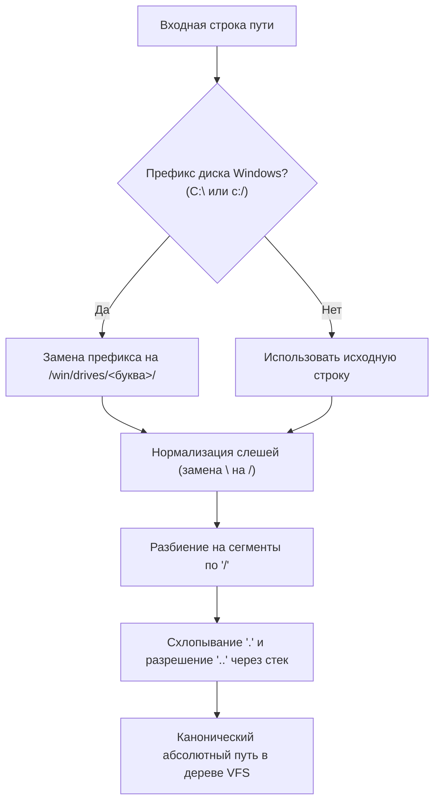
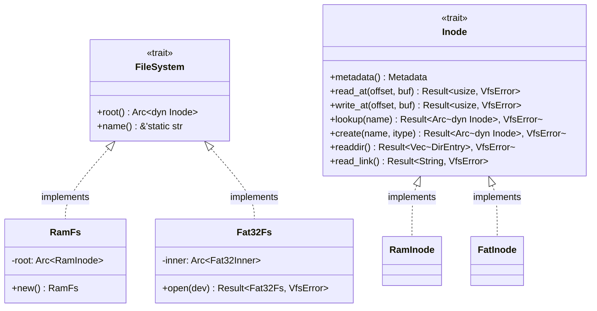

[ 🇷🇺 Русский ](vfs.ru.md) | [ 🇬🇧 English ](vfs.en.md)

# Виртуальная файловая система (VFS) и гибридная архитектура путей

Виртуальная файловая система (**VFS**) операционной системы Wunix решает фундаментальную задачу объединения двух различных парадигм проектирования ОС — классической иерархии **UNIX** и объектно-дисковой модели **Windows NT** — внутри единого монолитного дерева ядра на базе абстракций языка Rust.

---

## 1. Концепция гибридного монолитного дерева

В традиционных гибридных средах (например, WSL или Wine) совмещение сред достигается либо запуском легковесной виртуальной машины, либо трансляцией системных вызовов в пользовательском пространстве с эмуляцией путей. В Wunix гибридная архитектура заложена **на уровне самого ядра**:

1. **Единый корень `/`**: вся файловая система представляет собой единое направленное дерево графа Inode.
2. **Параллельное сосуществование пространств**:
   - Стандартная иерархия POSIX (`/bin`, `/sbin`, `/etc`, `/dev`, `/home`, `/proc`, `/sys`, `/mnt`, `/tmp`, `/var`) обслуживает нативные UNIX-демоны, стандартные потоки ввода-вывода и утилиты командной строки.
   - Изолированная ветка подсистемы NT (`/win/drives/c/`, `/win/registry/`) предоставляет нативную среду обитания для портируемых бинарников Windows, реестра и подсистемы NT Object Manager.
3. **Отсутствие раздельных дисковых букв на уровне ядра**: концепция дисковых накопителей Windows (`C:`, `D:`) является синтаксической проекцией, прозрачно транслируемой VFS в точки монтирования `/win/drives/<буква>/`.

```
/ (Единый корень VFS)
├── bin/                       # Нативные системные утилиты Wunix
├── dev/                       # Устройства ввода-вывода (vda, vda1, tty, null, zero)
├── etc/                       # Системная конфигурация (os-release, hostname, locale)
├── home/                      # Домашние каталоги пользователей
│   └── user/                  # Профиль текущего пользователя (/home/user)
├── mnt/                       # Точка монтирования постоянных дисков (FAT32 /dev/vda1)
├── proc/                      # Псевдо-ФС состояния процессов и ядра (uptime, meminfo, mounts)
├── sys/                       # Иерархия устройств и PCI-шин (devices/pci)
├── tmp/                       # Временные файлы общего доступа
└── win/                       # Пространство подсистемы Windows NT
    ├── drives/
    │   └── c/                 # Проекция диска C:\
    │       ├── Program Files/
    │       ├── Users/
    │       │   └── user ────► [Символическая ссылка на /home/user]
    │       └── Windows/System32/
    └── registry/              # Файлы ульев реестра (SYSTEM, SOFTWARE)
```

---

## 2. Механизм трансляции путей и правила разрешения

Все операции ввода-вывода ядра (`vfs::open`, `vfs::read_file`, `vfs::write_file`, `vfs::mkdir_p`) принимают строковые пути в произвольном формате (как в нотации POSIX, так и в синтаксисе Windows) и обрабатывают их через модуль [`fs/path.rs`](file:///home/valdis/my-os/wunix/kernel/src/fs/path.rs).

### 2.1. Алгоритм трансляции (`translate_path`)



1. **Детектирование дисков Windows**: если строка начинается с латинской буквы и двоеточия (например, `C:` или `c:`), префикс преобразуется в `/win/drives/<drive_letter>/`, где буква диска всегда переводится в нижний регистр.
2. **Унификация разделителей**: обратные слеши `\` преобразуются в прямые `/`.
3. **Разрешение относительных сегментов (`normalize_path`)**:
   - Пустые элементы и одиночные точки `.` игнорируются;
   - Переходы `..` извлекают последний сегмент из стека пути;
   - Выход за пределы корня невозможен: попытка применить `..` к корню сохраняет путь `/`.

### 2.2. Примеры нормализации

| Входной путь | Канонический путь VFS | Примечание |
|---|---|---|
| `C:\Windows\System32\drivers` | `/win/drives/c/Windows/System32/drivers` | Трансляция буквы диска и обратных слешей |
| `c:/windows/../program files` | `/win/drives/c/program files` | Схлопывание перехода `..` |
| `C:` | `/win/drives/c` | Корневая директория тома |
| `\\server\share\file` | `/server/share/file` | Сетевые UNC-префиксы сводятся к дереву VFS |
| `/etc/../etc/os-release` | `/etc/os-release` | Нативный путь POSIX |

### 2.3. Регистронезависимый поиск в поддереве NT

Файловые системы UNIX чувствительны к регистру символов (`case-sensitive`), тогда как Win32 и NT Object Manager ожидают регистронезависимого поведения (`case-insensitive`): вызов открытия `c:\windows\system32` обязан находить каталог `System32`.

В Wunix эта задача решена на уровне узлов директорий:
1. Функция `is_windows_subsystem(path)` определяет, попадает ли путь в ветку `/win` или `/win/...`.
2. При вызове `Inode::lookup(name)` в директории:
   - Сначала выполняется точный поиск по красно-черному дереву `BTreeMap` за $O(\log N)$.
   - Если точное совпадение не найдено, но директория помечена флагом `case_insensitive` (или поиск идет по подсистеме `/win`), ядро выполняет итерацию по дочерним записям со сравнением `key.eq_ignore_ascii_case(name)`.
3. Все директории, создаваемые внутри ветки `/win`, автоматически наследуют признак `case_insensitive = true`.

### 2.4. Разрешение символических ссылок

Функция `resolve_path(path, follow_last_symlink)` осуществляет пошаговый обход сегментов пути:
- Если промежуточный узел является символической ссылкой (`InodeType::Symlink`), ядро читает адрес назначения через `read_link()`.
- Относительные ссылки конкатенируются с текущим родительским каталогом, абсолютные перезапускают обход от корня.
- **Защита от зацикливания**: счетчик переходов ограничен глубиной 16 (`symlink_depth > 16`), при превышении которой возвращается ошибка `VfsError::InvalidPath`.

---

## 3. Единый профиль пользователя

Ключевая проблема гибридных ОС — дублирование и рассинхронизация пользовательских файлов (документы, конфигурации, ключи SSH), когда условный «пользователь Windows» и «пользователь Linux» изолированы в разных каталогах.

В Wunix архитектурно закреплена концепция **единого профиля**:
- Физическим хранилищем учетной записи является канонический каталог `/home/user`.
- При инициализации VFS ядро автоматически монтирует структуру каталогов `/win/drives/c/Users` и создает символическую ссылку:
  ```
  /win/drives/c/Users/user  ───(Symlink)───►  /home/user
  ```
- Любое Win32-приложение, запрашивающее путь `C:\Users\user\Documents`, прозрачно попадает в `/home/user/Documents`. При этом POSIX-утилиты видят те же самые файлы без конвертации путей или сетевых сокетов.

---

## 4. Иерархия типов и абстракций VFS

Архитектура VFS спроектирована на основе типажей (Rust traits) в [`fs/vfs.rs`](file:///home/valdis/my-os/wunix/kernel/src/fs/vfs.rs):



### 4.1. Типаж `Inode`

Каждый объект в дереве VFS (файл, директория, символическая ссылка, блочное или символьное устройство) реализует типаж `Inode`:

```rust
pub trait Inode: Send + Sync {
    fn metadata(&self) -> Metadata;
    fn read_at(&self, offset: usize, buf: &mut [u8]) -> Result<usize, VfsError>;
    fn write_at(&self, offset: usize, buf: &[u8]) -> Result<usize, VfsError>;
    fn lookup(&self, name: &str) -> Result<Arc<dyn Inode>, VfsError>;
    fn create(&self, name: &str, itype: InodeType) -> Result<Arc<dyn Inode>, VfsError>;
    fn readdir(&self) -> Result<Vec<DirEntry>, VfsError>;
    fn read_link(&self) -> Result<String, VfsError>;
}
```

- Требование `Send + Sync` обеспечивает безопасную передачу индексных дескрипторов между потоками ядра и обработчиками прерываний.
- Все методы имеют безопасные реализации по умолчанию, возвращающие ошибки `Err(VfsError::NotADirectory)` или `Err(VfsError::NotSupported)`.

### 4.2. Метаданные и ошибки

- `InodeType`: строго типизированное перечисление типов узлов (`File`, `Directory`, `Symlink`, `CharDevice`, `BlockDevice`).
- `Metadata`: базовые атрибуты узла (тип, размер в байтах, уникальный номер `inode_id`, права доступа POSIX `permissions`).
- `DirEntry`: элемент каталога, возвращаемый операцией `readdir()` (`name`, `inode_id`, `itype`).
- `VfsError`: исчерпывающее перечисление ошибок файловых операций:
  - `NotFound` — узел не найден;
  - `IsADirectory` / `NotADirectory` — несовпадение типа операции и типа узла;
  - `PermissionDenied` — отказ в доступе по маске прав;
  - `AlreadyExists` — запись уже существует;
  - `InvalidPath` — некорректный синтаксис пути или превышение глубины симлинков;
  - `IoError` — аппаратная ошибка ввода-вывода или сбой аллокации;
  - `NotSupported` — операция не поддерживается данной конкретной ФС.

---

## 5. Файловые дескрипторы и типаж `FileHandle`

Для поддержки концепции UNIX «Всё есть файл» в модулях [`fs/handle.rs`](file:///home/valdis/my-os/wunix/kernel/src/fs/handle.rs) и [`fs/fd.rs`](file:///home/valdis/my-os/wunix/kernel/src/fs/fd.rs) реализована универсальная абстракция дескриптора открытого ресурса `FileHandle`:

```rust
pub trait FileHandle: Send + Sync {
    fn read(&self, buf: &mut [u8]) -> Result<usize, i64>;
    fn write(&self, buf: &[u8]) -> Result<usize, i64>;
    fn poll_events(&self) -> u32;
    fn get_flags(&self) -> u32;
    fn set_flags(&self, flags: u32);
    fn close(&self);
    fn as_inode(&self) -> Option<Arc<dyn Inode>>;
    fn offset(&self) -> usize;
    fn set_offset(&self, offset: usize);
    fn epoll_ctl(&self, op: u32, fd: u64, event_ptr: u64) -> Result<u64, i64>;
}
```

### Разновидности реализаций `FileHandle`:
1. **`InodeHandle`**: Обычные файлы и каталоги VFS со смещением чтения/записи `offset`.
2. **`StdinHandle` / `StdoutHandle`**: Дескрипторы стандартного ввода (чтение скан-кодов клавиатуры PS/2) и вывода (отрисовка во фреймбуфер Limine с ANSI-парсингом и дублированием в COM1 UART).
3. **`PipeHandle`**: Однонаправленные кольцевые буферы IPC для конвейеров командной оболочки (`cmd1 | cmd2`).
4. **`SocketHandle`**: Сетевые сокеты TCP/UDP/ICMP, транслирующие вызовы `read`/`write` в сетевой стек `smoltcp`.
5. **`EventFdHandle`**: Межпоточные 64-битные счетчики сигналов.
6. **`EpollHandle`**: Асинхронные реакторы событий ввода-вывода.

Таблица дескрипторов `FdTable` изолирована внутри каждого процесса и поддерживает флаги `O_CLOEXEC` и `O_NONBLOCK`.

---

## 6. Блочный слой `BlockDevice` и драйвер FAT32

Для долговременного хранения данных на физических накопителях и образах VirtIO в ядре реализован блочный уровень:

### 6.1. Блочные устройства и разделы MBR (`fs/block.rs`)
- Трейт `BlockDevice` определяет синхронное блочное чтение и запись (`read_sectors`, `write_sectors`) секторами по 512 байт.
- При обнаружении блочного накопителя (например, `virtio-blk` на шине PCI) в каталоге `/dev` создается узел устройства `/dev/vda`.
- Ядро считывает нулевой сектор MBR, проверяет сигнатуру `0x55AA`, парсит 4 записи таблицы разделов и автоматически создает дескрипторы разделов (например, `/dev/vda1`).

### 6.2. Драйвер файловой системы FAT32 (`fs/fat.rs`)
- **Чтение заголовка BPB**: Ядро анализирует сектор 0 раздела (BIOS Parameter Block), определяет размер кластера (обычно 4 КиБ = 8 секторов), число зарезервированных секторов, количество таблиц FAT и корневой кластер.
- **Кластерные цепочки**: Чтение файла осуществляется по цепочке FAT32-записей до маркера конца цепочки `FAT32_EOC` (`0x0FFF_FFFF`).
- **Кэширование секторов**: Для минимизации обращений к шине I/O таблица FAT и секторы каталогов кэшируются в памяти ядра.
- **Поддержка длинных имен (LFN)**: Обрабатываются атрибуты `FAT32_ATTR_DIRECTORY`, `FAT32_ATTR_READ_ONLY`, а также LFN-записи.

---

## 7. Подсистема точек монтирования (`fs/mount.rs`)

Ядро поддерживает динамическую таблицу монтирования файловых систем:
- Системный вызов `sys_mount(source, target, fstype, flags, data)` монтирует файловую систему в указанный каталог VFS.
  - Пример: монтирование раздела `/dev/vda1` (FAT32) в точку `/mnt`.
- Системный вызов `sys_umount2(target, flags)` корректно освобождает точку монтирования и сбрасывает кэши на диск.
- Все смонтированные тома экспортируются в текстовом виде в виртуальный файл `/proc/mounts`.

---

## 8. Синтетические файловые системы: ProcFS и SysFS

Для мониторинга системы и оборудования модуль [`fs/procfs.rs`](file:///home/valdis/my-os/wunix/kernel/src/fs/procfs.rs) формирует псевдофайлы, динамически генерирующие текстовые данные по запросу:

| Путь к псевдофайлу | Предоставляемые данные | Использующие утилиты |
|---|---|---|
| `/proc/uptime` | Время работы системы в секундах и миллисекундах | `top`, `wsh`, `date` |
| `/proc/meminfo` | Общий, свободный и используемый объем RAM | `free`, `top` |
| `/proc/cpuinfo` | Данные CPUID, модель процессора, флаги инструкций | `lshw`, `uname` |
| `/proc/version` | Название ядра Wunix, версия и дата сборки | `uname`, `dmesg` |
| `/proc/mounts` | Список активных точек монтирования файловых систем | `mount`, `df`, `lsblk` |
| `/proc/net/dev` | Статистика принятых/отправленных пакетов интерфейсов | `ip`, `ss` |
| `/sys/devices/pci` | Дерево PCI-устройств с Vendor/Device ID и именами | `lspci`, `lshw` |

---

## 9. Подсистема виртуального реестра Windows NT (`fs/registry/`)

Для обеспечения совместимости с Win32-приложениями и хранения системных настроек подсистемы NT в дереве VFS размещена ветка `/win/registry/`:

- **Ульи реестра (Registry Hives)**:
  - `HKEY_LOCAL_MACHINE\SYSTEM` $\to$ `/win/registry/SYSTEM`
  - `HKEY_LOCAL_MACHINE\SOFTWARE` $\to$ `/win/registry/SOFTWARE`
- **Типы параметров**:
  - `REG_SZ`: строковые параметры (например, версии системы, имена драйверов, пути к системным библиотекам).
  - `REG_DWORD`: 32-битные числовые параметры (таймауты, флаги режимов).
  - `REG_BINARY`: бинарные данные конфигурации.
- Доступ к реестру осуществляется как через специализированные системные вызовы Windows NT (`NtOpenKey`, `NtCreateKey`, `NtQueryValueKey`, `NtSetValueKey`), так и через консольную утилиту `reg` (`reg query`, `reg add`).

---

## 10. Дорожная карта развития подсистемы хранения

1. **Этап 1 (Завершено)**: Базовые трейты VFS (`Inode`, `FileSystem`), in-memory RamFS, механизм трансляции путей `C:\`, парсер архивов ustar initramfs, монтирование корня `/`.
2. **Этап 2 (Завершено)**: Блочный слой `BlockDevice` (`/dev/vda`), парсинг разделов MBR (`/dev/vda1`), драйвер **FAT32** с кэшированием секторов, системные вызовы `mount`/`umount2` (монтирование физического накопителя в `/mnt`), динамические псевдо-ФС `ProcFS` и `SysFS`, реестр Windows NT.
3. **Этап 3 (В разработке)**: Драйвер **EXT2/EXT4** для организации постоянного корневого раздела UNIX на диске.
4. **Этап 4 (В планах)**: Подсистема кэширования страниц диска (Page Cache) со стратегией отложенной записи (write-back) и системным вызовом `sync`.
